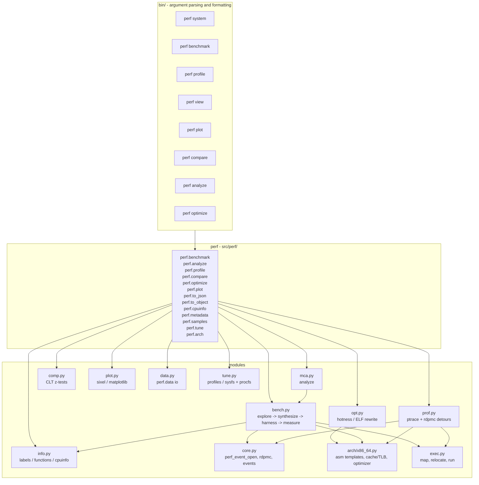
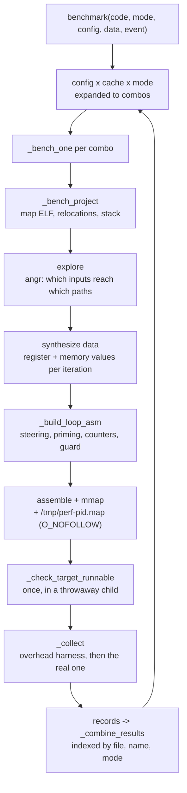

## Architecture

The library is one library and eight commands. Everything a command does is a
function in `src/perf/`, re-exported from `perf`, so `import perf` is the whole
API and the CLI adds nothing but argument parsing, formatting and `--json`.



### `benchmark`

One call is: expand the config into concrete combinations, run each one, tag
the columns, concatenate.



- `analyze` reuses exploration but stops there: it disassembles the target and
  reports what the states say, per instruction, without measuring.
- `profile` does not use the harness at all — it patches the running process.
- `compare`, `plot` and `view` never touch a counter; they take the DataFrame
  the others produced.

### `analyze`

`analyze` follows the same first two steps as `benchmark` (map, explore,
attach the explored values) and then disassembles the target, one row per
instruction, with OSACA-modelled `latency`/`throughput` merged with whatever
was measured for that address. No JIT, no counters.

### `optimize`

`optimize` applies measured-data-guided, address-preserving passes to an ELF
binary. The arch-specific primitives live in `arch/x86_64.py`: optimal NOPs,
same-size peepholes (`mov r,r`, `xchg r,r`, `lea r,[r]`, `lea r,[r*1]`,
`shift r,0`, `movabs` shrinking), branch folding and conditional inversion,
reachability filtering so embedded data and padding are never rewritten, and
text verification. `opt.py` keeps the ELF-level work: function discovery,
hotness aggregation from benchmark/profile/`perf.data`/analyze data, layout,
and fixups for rel32 branches, RIP-relative memory, RELA addends,
`.eh_frame` FDEs, the `.eh_frame_hdr` lookup table, symbol tables and the
entry point. Functions with indirect jumps or exception tables stay in the
original layout; non-PIE binaries skip `layout`/`align`, and fixup failures
fall back to the original order. Only statically reachable instructions are
rewritten, so embedded data and padding stay verbatim. The output defaults to
`EXEC.opt<EXT>` when no `output=` is given. Layout rewrites the whole `.text`
so the output remains valid.
Passes,
alignment and layout order come from a config (`opt`, `layout.align`,
`layout.order`) merged over the defaults. The result frame carries `name`,
`address`, `new_address`, `size`, `new_size`, `hotness`, `moved`, and per-pass
stats plus fixup counts in `attrs`.

### `profile`

`profile` starts the program under `ptrace`, patches an `int3` at the entry so
the exec trap fires, and redirects every tracked address to a `rdpmc` detour
that appends to a ring buffer shared with the parent through a sparse temporary
file mapped into the child's address space. Per-hit counts cost no signal and
no syscall in the child; the parent reads the occupied slots back after the run.
Detour code is generated in `arch/x86_64.py`
(`build_profile_detour`, `relocate_detour_bytes`), including the RIP-relative
fixups a detour displaces.

### `view/plot`

`view` reshapes and aggregates a DataFrame; `plot` draws it (sixel or ASCII in
a terminal based on capabilities queried once and cached, matplotlib to a
file);

### `compare`

`compare` tests two variants with a CLT z-test on the mean and on the
geometric mean, and calls a difference significant only if both reject.
Runs are matched on their `mode` and every `data.*` value (all of which are
shown in the result), not on the benchmark name or binary, so different
builds and names with the same inputs can be compared. The normal
approximation needs at least 30 samples per side, so smaller groups are not
compared; when a group has no challenger the baseline row is still shown.
`diff` shows `-` when not significant, otherwise a signed percentage (`-`
faster, `+` slower), so a shown value implies significance.

### `system`

`system info --cpu` answers "what is this machine?": CPU topology from sysfs.
`system tune` answers "is the machine set up for stable measurements?" and
applies a profile through `/sys`, `/proc` and `/dev` (governor, EPP, CPU
frequency, turbo/boost, the `turbo_msr` fallback, SMT, ASLR, NMI/watchdog,
NUMA balancing, THP/defrag, KSM, swappiness, stat interval, timer migration,
perf event sample/mlock limits, `perf_event_paranoid`, `kptr_restrict`,
`sched_autogroup_enabled`, `sched_rt_runtime_us`). It also covers the
pyperf tuning knobs: IRQ balancing and affinity (incl. per-IRQ masks),
power-supply state, `isolcpus`/`rcu_nocbs`/`nohz_full`. The two benchmark presets are deliberately
different: `latency` disables turbo/boost and SMT for low jitter and requires
isolation, while `throughput` keeps turbo/boost and SMT on and enables THP.
JSON profiles merge over `default`, and `--profile.KEY=VALUE` overrides any
leaf; `perf.tune(profile=..., overrides=..., dry_run=...)` returns the same
per-setting frame the CLI formats. `perf benchmark FILE --list`
(`perf analyze FILE --list`, `perf profile --list -- FILE`) answers "what is
in this file?": `.perf.label` sections (from `lib/perf/`), functions from
`angr.CFGFast`. It is what every other command points users at when a target
name does not resolve.

# API

All public entry points are re-exported from `perf`, so `import perf` is the
whole import. The Python API takes the same `symbol` / `region` / `asm` /
`config` / `data` / `event` values as the CLI — see [bin/README.md](../bin/README.md)
for the CLI reference (flags, `--config` / `--data` keys, events, the output
envelope, `.perfconfig`). `perf view` and `perf system` are CLI-only: they format
and list what `perf.benchmark` measures and `perf.metadata` describes.
Output selection (`-o`), JSON envelopes (`--json`), interactive sessions (`-i`),
target listing (`--list`), environment/argv (`--env`, `-- ARGS`), `--debug`
and `--backend` remain CLI-only; `results=` (`analyze`), `output=`/`buffer-size`
(`profile`), `path=` (`to_object`), `bin=`/`fields=` (`samples`) and
`on=`/`variant=` (`compare`) remain Python-only.
`perf.compare` detects the variant column (`name`, `file`, or the data source)
the same way the CLI does unless `variant=` is given, and with no `event=`
compares every measured event per operation like the CLI does; both take
`filter=` like the CLI `-f` flag. `perf.plot` with no `event=` charts
`duration_time` when present and otherwise falls back to every measured
event, while the CLI defaults to one per-operation chart per measured event;
both take `filter=` like the CLI `-f` flag. `perf.benchmark` defaults to both
modes like the CLI when `mode=` is omitted. `perf.optimize` takes a binary
`exec=` (`"a.out"`), `output=` (defaults to `a.opt.out`), `data=`, `opt=`,
`config=` and `dry_run=`;
`config` carries `opt` and a `layout`
object (`align`, `order`) merged over the defaults. It returns the per-function
frame described under [optimize](#optimize), with pass and fixup statistics in
`attrs`.

Public API is `arch`, `benchmark`, `profile`, `analyze`, `compare`, `optimize`, `plot`,
`samples`, `to_json`, `to_object`, `cpuinfo`, `metadata`, `tune`. `arch` resolves both an architecture name and a
project; `cpuinfo.format_hz` formats frequencies; `metadata.perf_labels`,
`metadata.asm_labels`, and `metadata.functions` are accessed through `metadata`;
`samples.nest`, `samples.spread`, `samples.parse`, `samples.metrics` and
`samples.is_record` are accessed through `samples`. `perf.to_json` records
`hostname` (`info.hostname()`) alongside `cpu` in its `info` section.
`perf.benchmark` dumps every measured iteration (one row per loop trip with
its scalar `data.*` input, in slot order); `perf view`, `perf plot`
and `perf compare` read that shape as-is.

## `symbol`, `region` and `asm`

`perf.benchmark` and `perf.analyze` take a binary symbol as `symbol`, a
binary region as `region`, and a raw asm snippet as `asm`: a `[file, symbol]`
pair, a `[file, (begin, end)]` pair, or a raw asm snippet.
A `"file:symbol"` / `"file:begin..end"` string is accepted as a shorthand
for the pair form.

```py
symbol = ["a.out", "func"]  # function of a binary
region = ["a.out", ("hot_begin", "hot_end")]  # region of a binary
symbol = ["foo.s", "foo"]  # label of an assembly source
region = ["foo.s", ("foo", "bar")]  # region of an assembly source
symbol = "a.out:func"  # shorthand string for the pair form
asm = "mov eax, 42"  # raw asm snippet (no file)
```

## `argv` and `env`

`benchmark(argv=..., env=...)` gives the target a process to run as. The CLI
spells it `-- ARGS...` after `--env KEY=VALUE`, so
`perf benchmark /usr/bin/tree:main -m latency -- /path/to/folder` measures
`main(2, ["/usr/bin/tree", "/path/to/folder"], envp)`: the CLI prepends the
program named by `CODE` as `argv[0]` when the first word after `--` is not
already that program. The Python `argv` is the same list spelled out,
including `argv[0]`:

```py
df = perf.benchmark(
    symbol=["/usr/bin/tree", "main"],
    mode=["latency"],
    argv=["/usr/bin/tree", "/path/to/folder"],
    env=["LANG=C.UTF-8"],
)
```

`Elf.setup_argv` (`src/perf/exec.py`) writes the strings, `argc`, `argv`,
`envp` and an `AT_*` auxiliary vector into the mapped stack, and
`arch.argv_asm` (`src/perf/arch/x86_64.py`) puts `argc`/`argv`/`envp` into
`rdi`/`rsi`/`rdx` before the call and points `rsp` at the image for the
duration of the loop. The words are `argv` as a shell would pass them, so the
first is `argv[0]`; an empty list means `argv[0]` is `file` and `argc` is 1. `--data.rdi`, `--data.rsi` and
`--data.rdx` are refused while `argv` is set: the ABI already decides those
three.

## Synopsis

```py
import perf

# benchmark: a mode is a list, events/config/data mirror the CLI flags
df = perf.benchmark(symbol=["a.out", "func"], mode=["latency"], event=["duration_time"])
df = perf.benchmark(
    region=["a.out", ("hot_begin", "hot_end")],
    mode=["latency"],
    event=["topdown-*"],
    data={"regs": {"rdi": 15}},
)
df = perf.benchmark(
    symbol=["/usr/bin/tree", "main"],
    mode=["latency"],
    argv=["/usr/bin/tree", "/path/to/folder"],
)
df = perf.benchmark(asm="mov eax, 42", mode=["latency"], event=["cycles"])
df = perf.benchmark(symbol=["a.s", "myfunc"], mode=["latency"])
df = perf.benchmark(region=["foo.s", ("foo", "bar")], mode=["latency"])
df = perf.benchmark(
    symbol=["a.out", "func"],
    mode=["latency", "throughput"],
    config={"dcache": ["hot", "cold"]},
)
df = perf.benchmark(
    asm="mov rax, [rdi]",
    mode=["latency"],
    config={
        "code": [{"align": 1}, {"align": 32}],
        "thread": [[{"numa": 0, "affinity": 1, "priority": "normal"}]],
    },
)

# per-instruction analysis (index 0..n, one row per instruction)
df = perf.analyze(symbol=["a.out", "func"])
df = perf.analyze(region=["foo.s", ("foo", "bar")])
df = perf.analyze(
    region=["a.out", ("hot_begin", "hot_end")],
    event=["assembly", "encoding"],
)
df = perf.analyze(symbol=["a.out", "func"], event=["data*"])
df = perf.analyze(symbol=["a.out", "func"], event=["*"])
df = perf.analyze(symbol=["a.out", "func"], filter="latency > 4")
df = perf.analyze(asm="mov rax, rdi", results=df)
df = perf.analyze(symbol=["a.out", "func"], data={"regs": {"rdi": 15}})
df = perf.analyze(symbol=["a.out", "func"], filter="15 in `data.rdi`")
df = perf.analyze(symbol=["a.out", "func"], setup="a.out:init", teardown="a.out:fini")

# binary optimization (benchmark/profile/perf.data/analyze guide hot layout)
df = perf.optimize(exec="a.out", output="b.out", data=["data/"])
df = perf.optimize(exec="a.out", output="b.out", opt=["peephole", "branch"])
df = perf.optimize(
    exec="a.out",
    output="b.out",
    config={"opt": ["layout"], "layout": {"align": 64}},
)

# labels of an assembly source as (name, position, size) in the file
print(perf.metadata.asm_labels("foo.s"))
print(perf.metadata("a.out"))
print(perf.samples("perf.data"))

# relocatable object of the measured target
path = perf.to_object(symbol=["a.out", "func"], path="bench.o")
path = perf.to_object(region=["a.out", ("hot_begin", "hot_end")], path="region.o")
json = perf.to_json(df, indent=4)

# binary/cpu metadata (metadata.perf_labels, metadata.functions, hostname)
cpu = perf.cpuinfo()
print(perf.cpuinfo.format_hz(cpu["freq"].iloc[0]))
meta = perf.metadata("a.out")

# live profiling (labels, functions, hex addresses or (begin, end) regions)
df = perf.profile(cmd=["./a.out"], event=["cycles"], select=["hot"])
df = perf.profile(cmd=["./a.out"], event=["cycles"], select=["func"])
df = perf.profile(
    cmd=["./a.out"], event=["cycles"], select=[("work_begin", "work_end")]
)

# compare
cmp = perf.compare(df, baseline="base")

perf.plot(df, type=["ecdf"], event=["cycles"])
```

`data` accepts the flat (`{"rdi": 15}`) and the grouped (`{"regs": {"rdi": 15},
"mem": {...}}`) forms interchangeably. `mode` defaults to both modes like
the CLI when omitted.

# Examples

Every command below was run on this machine (x86-64, Linux 6.x, Ubuntu 23.04,
Python 3.11) and the output is what it printed. Hardware and hardware-cache
events need user-space `rdpmc`; `duration_time` works without it.

Work in one directory:

```sh
git clone https://github.com/perf-labs/perf.git && cd perf
pip install -e .
mkdir -p /tmp/work && cd /tmp/work
cp -r ~/perf/lib .          # the zero-instruction code markers
gcc --version               # the fixtures below are C and C++
```

## A binary to measure

```c
// fizz.c
#include "perf/perf.h"

int add42(int x) { return x + 42; }

const char *func(int n) {
    PERF_LABEL(fizz_begin);
    const char *r = "Unknown";
    if (n % 15 == 0) r = "FizzBuzz";
    else if (n % 3 == 0) r = "Fizz";
    else if (n % 5 == 0) r = "Buzz";
    PERF_LABEL(fizz_end);
    return r;
}

int hot(int n) {
    PERF_LABEL(hot_begin);
    int s = 0;
    for (int i = 0; i < n; ++i) s += i;
    PERF_LABEL(hot_end);
    return s;
}

int main() {
    return func(15)[0] + add42(1) + hot(10); 
}
```

```sh
gcc -O2 -I lib -o fizz fizz.c
./fizz; echo $?     # 158, the first character of "FizzBuzz"
```

`PERF_LABEL` emits no instructions (see [lib/README.md](lib/README.md)); it
marks a spot so `perf benchmark` and `perf profile` can target it.

## What is in this file

Everything you can measure is listed, with the address you would pass:

```sh
$ perf benchmark fizz --list | head -6
kind  begin     end       size  name
label  0x401174  0x401174        fizz_begin
label  0x4011a6  0x4011a6        fizz_end
label  0x4011e4  0x4011e4        hot_begin
label  0x4011f9  0x4011f9        hot_end
func   0x4011e0  0x401204    36  hot

$ perf benchmark fizz --list | grep func
func   0x4011e0  0x401204    36  hot
func   0x401170  0x4011d6   102  func
func   0x401160  0x401168     8  add42
```

## A function

```sh
$ perf benchmark fizz:func -m latency -e cycles,instructions --data.arg0=15
file            name       mode     config.backend.loop.probes  ...  data.arg0  cycles  instructions  operations  duration_time
fizz@2cd68638   func  latency                            3.00  ...      15.00  168254           97           1         3.00         9.00
fizz@2cd68638   func  latency                            3.00  ...      15.00  168254           98           1         3.00         9.00
fizz@2cd68638   func  latency                            3.00  ...      15.00  168254           99          99           1         3.00         9.00
```

`--data.arg0=15` is the argument (`rdi`); `arg0`/`arg1`/... are the registers
that pass arguments in the System V ABI. `cycles/operations` is 3 cycles for
the `15 % 15 == 0` path and 9 for the two multiplies it skips.

## An assembly snippet

No file at all — the argument is Intel-syntax assembly:

```sh
$ perf benchmark 'imul eax, 0' -m latency -e cycles,instructions
name      mode      config.backend.unroll.count  ...  operations  duration_time
imul ...  latency                            5.00  ...           1         3.00         1.00
```

One multiply is 1 cycle here; `duration_time` is the wall-clock the TSC saw.

## A region of a function

Narrow the target to the part you suspect, with the labels from the same file:

```sh
$ perf benchmark 'fizz:hot_begin..hot_end' -m latency -e cycles --data.arg0=10
file           name              mode     ...  data.arg0  cycles  operations  duration_time
fizz@2cd68638  hot_begin..hot_end  latency  ...      10.00   43371           1         6.00
```

The same loop as a whole is `perf benchmark fizz:hot -m latency --data.arg0=10`;
the difference between the two is the setup and the call.

## Sweeping the input in one run

A comma-separated value sweeps; a repeated flag does not:

```sh
$ perf benchmark fizz:func -m latency -e cycles --data.arg0=[1,3,5,15]
```

gives one row per value, each with its own path through the branches, and the
`data.arg0` column says which is which. `--data.arg0=15` with no brackets is a
single measurement.

## C++ member functions

`perf benchmark` calls the target, so a member function needs `this` in `rdi`
and the object fields at the addresses the code dereferences. Give it an object
of its own — an address for `this` plus the field bytes — with `--setup` /
`--teardown` restoring the globals between iterations. See
[Member functions](../bin/README.md#member-functions) for the full example:

```sh
$ g++ -O2 -I lib -o counter counter.cpp
$ perf benchmark 'counter:Counter::member(long)' -m latency \
    -e cycles,instructions --setup counter:setup --teardown counter:teardown \
    --data.rdi=0x42000000000 --data.rsi=1000 \
    --data[0x42000000000:]=1 --data[0x42000000008:]=3
```

The target is the demangled name exactly as `--list` prints it.
`--data[ADDR:]=BYTES` writes the fields (`value` at `this+0`, `step` at
`this+8`). The target alone is `counter:member_begin..member_end` with the same
data.

## libc.so

A shared library is a target like any other; `perf benchmark "$LIBC" --list` lists its exported
symbols. An indirect function resolves to the implementation the loader picked
for *this* CPU, so this is the `strlen` this machine runs, not a reference one.

`strlen` needs a pointer, so give it one with `--data`:

```sh
$ LIBC=/usr/lib/x86_64-linux-gnu/libc.so.6
$ perf benchmark "$LIBC:strlen" -m latency -e cycles \
    --data.rdi=0x4200000000 --data[0x4200000000:]=hello
file               name    mode     ...  cycles  operations  duration_time
libc.so.6@c3a14ee6 strlen  latency  ...    346.00           1       116.00
```

Sweep the length to see the per-byte cost:

```sh
$ perf benchmark "$LIBC:strlen" -m latency -e cycles \
    --data.rdi=0x4200000000 --data[0x4200000000:]=aaaaaaaaaaaaaaaa
libc.so.6@c3a14ee6 strlen latency ...  364.00 ...   # 16 bytes
```

Two pointers, a length:

```sh
$ perf benchmark "$LIBC:strcpy" -m latency -e cycles \
    --data.rdi=0x4200000000 --data.rsi=0x4200001000 \
    --data[0x4200000000:]=0123456789abcdef \
    --data[0x4200001000:]=fedcba9876543210
libc.so.6@c3a14ee6 strcpy latency ...  ...            # works
```

Use `--data[ADDR:]=` (with the colon) to write a run of bytes; without it the
harness has no contents for the address and the call faults, which is reported
as such rather than as a wrong number.

## libstdc++.so

Same thing with the C++ ABI: pass the demangled name, and the arguments in the
registers that pass them.

```sh
$ LIBCXX=/usr/lib/x86_64-linux-gnu/libstdc++.so.6
$ perf benchmark "$LIBCXX:std::locale::_S_normalize_category(int)" \
    -m latency -e cycles --data.rdi=8
libstdc++.so.6@a8d61b97 std::locale::_S_normalize_category(int) latency ...
```

`perf benchmark "$LIBCXX" --list | head` lists 6,000 exported symbols; the version suffix
(`@@GLIBCXX_3.4`) is not part of the name you pass. The mangled name does not
resolve — pass the demangled one.

## A program in /usr/bin

`main` of an installed program is a target like any other:

```sh
$ perf benchmark /usr/bin/ls:main -m latency -e cycles
ls@34eda017 main latency  3.00  10.00  0.01  unpredictable  ...

$ perf benchmark /usr/bin/id:main -m latency -e cycles
id@3f477152 main latency  3.00  10.00  0.01  unpredictable  ...
```

This works for a position-independent program. A distro build that is not
(`/usr/bin/gcc`, most system tools) is linked at `0x400000`, which is where this
process already is, so the run stops with the reason instead of overwriting
the process:

```sh
$ perf benchmark /usr/bin/gcc:main -m latency
cannot map '/usr/bin/x86_64-linux-gnu-gcc-12' (resolved from '/usr/bin/gcc')
at 0x400000-0x556000: this process is already using 0x400000-0x41f000. A
non-PIE executable can only be mapped at the address it is linked at ...
$ perf benchmark /usr/bin/gcc --list | head -3     # still works, it does not map anything
kind  begin     end       size  name
func  0x48de50  0x48df77   295  _obstack_newchunk
func  0x48de30  0x48de49    25  _obstack_begin_1
```

A function of a program you build yourself with `-fPIE -pie` has no such
problem.

## A program with its own arguments

Everything after `--` is the program's `argv`, the way a shell passes it:

```sh
$ perf benchmark /usr/bin/ls:main -m latency -e cycles -- /tmp/work
ls@34eda017 main latency  3.00  10.00  0.01  unpredictable  ...

$ perf benchmark /usr/bin/tree:main -m latency -- /home
tree@b3c9c390 main latency  3.00  10.00  0.01  predictable  ...
```

The words after `--` are the program's arguments; the program named by `CODE`
is prepended as `argv[0]` unless the first word already equals it. That call is
`main(2, ["/usr/bin/tree", "/home"], envp)`. A bare `--` with nothing after it
means `argv` is just the file you named and `argc` is 1. `argc` goes in `rdi`,
`argv` in `rsi` and `envp` in `rdx`, and the strings, the vectors and the
auxiliary vector are written into the harness's own
stack, so `getauxval()` answers for the image being measured. That stack is
laid out the way the kernel lays one out — the vectors at the stack pointer and
the strings above them, all of it above the pointer `main` starts from — so a
`main` with a frame of any size runs on clear stack of its own.

Whether a program's `main` survives being called on its own is the program's
business: `ls`, `id` and `tree` return, `cat` reads its standard input and never
comes back, and a function that dereferences a null pointer faults before it
does anything. A target that cannot run on its own is named and refused before
any measurement starts, rather than taking the process down with it:

```sh
$ perf benchmark a.out:crash -e cycles
'crash' faulted with a segmentation fault (SIGSEGV) when called on its own, so it cannot be measured in isolation ...
```

A method that needs an object someone else built is a different case: the data
it walks is *discovered*, not supplied. `q.o` has no `map::find` constructor —
the compiler elided it — so `unordered_map::find` runs against a container
nobody ever filled. The exploration already knows which register is the object
and which addresses it reads, so the harness lays those pages out and the method
is measured with no set-up at all:

```sh
$ perf benchmark q.o:map::find -e cycles
q.o@76a4e8ea map::find latency  3.00  10.00  0.01  predictable  hot  hot  hot  hot  ...  4.46ns
```

The `data.*` columns are that world: the keys it is asked for, and every cell
the walk touched (`data.0x4100010000` and its neighbours above are the
`unordered_map`'s own fields, `data.rsi` the keys). Each explored state is
replayed once before it is measured, and a state whose data does not come back
— a chain that walks into a cycle the exploration only left because one of its
reads was still symbolic — is dropped rather than allowed to hang the harness.
If every state is like that, the same addresses with nothing in them (an empty
container) are tried next. `--data` and `--setup` still win: whatever you pass
is what runs.

Benchmark the function a program spends its time in instead, or a `PERF_LABEL`
region around it.

Add to the environment with `--env`, repeated:

```sh
$ perf benchmark /usr/bin/ls:main -m latency --env LC_ALL=C -- /tmp/work
```

With no `--env` the environment is empty (`envp[0] == NULL`), the same as
`env -i`.

## Per-instruction view

`perf analyze` disassembles the target and never runs it, one row per
instruction, with the modelled cost of each:

```sh
$ perf analyze fizz:func --data.arg0=15 -e assembly,latency,throughput
assembly                                  latency throughput
endbr64
imul eax, edi, 0xeeeeeeef
lea rdx, [rip + 0xe83]    1.00    0.20
add eax, 0x8888888        1.00    0.20
cmp eax, 0x11111110       1.00    0.20
jbe .L4011a6
imul eax, edi, 0xaaaaaaab
```

With the default column set you also get the encoding, the address and the
`data.*` values the explored state puts in each register:

```sh
$ perf analyze fizz:hot_begin..hot_end --data.arg0=10 --filter 'latency > 0'
index file          name               address  encoding size latency throughput assembly      data.rdi
0     fizz@2cd68638 hot_begin..hot_end 0x4011e4 85 ff    2    1.00    0.20       test edi, edi [10]
2     fizz@2cd68638 hot_begin..hot_end 0x4011e8 31 c0    2    1.00    0.20       xor eax, eax  [10]
3     fizz@2cd68638 hot_begin..hot_end 0x4011ea 31 d2    2    1.00    0.20       xor edx, edx  [10]
5     fizz@2cd68638 hot_begin..hot_end 0x4011f0 01 c2    2    1.00    0.20       add edx, eax  [10]
6     fizz@2cd68638 hot_begin..hot_end 0x4011f2 83 c0 01 3    1.00    0.20       add eax, 1    [10]
```

`latency`/`throughput` come from an instruction-latency model (OSACA), not from
a measurement — `perf analyze` never counts anything. To see measured per-ip
counts, join a profile:

```sh
$ perf benchmark fizz:hot -m latency -e cycles -o data/
$ perf profile -f hot -e cycles -o profile.json -- ./fizz
$ perf analyze fizz:hot -- profile.json     # adds the measured per-ip events
```

## Live profiling

`perf profile` runs the program and counts at each tracked address, with no
harness and no per-call overhead beyond the `rdpmc` it reads:

```sh
$ perf profile -f func -e cycles -o profile.json -- ./fizz
tracked 1 samples -> profile.json
```

Targets are labels, function names, hex addresses or `begin..end` regions; a
label or a region gets a trampoline, so `--filter hot_begin..hot_end` costs
nothing per instruction. `--filter` is required.

## Compare two builds

```sh
$ perf benchmark a.old:func -n base --data.arg0=15 -m latency -e cycles -o old/
$ perf benchmark a.new:func -n cand --data.arg0=15 -m latency -e cycles -o new/
$ perf compare -b base -- old/ new/
baseline    challenger    mode     event               ci_low ci_high p_value alpha  diff
base-2f7fc9ad cand-2f7fc9ad latency cycles/operations -6.57%  +5.23%  0.7795  0.05  -
```

A difference is only called significant when a CLT z-test rejects on both the
arithmetic and the geometric mean. `-b` takes the name `perf benchmark -n`
recorded; `perf compare` prints the names it found if yours does not match.

## Look at the results

```sh
$ perf benchmark fizz:func -m latency -e cycles -o data/
$ perf view -s min,median,p99 -- data/          # a table
$ perf plot -t ecdf -e cycles -o plot.png -- data/   # a picture
$ perf plot --config.backend=window -e cycles -- data/  # a matplotlib window
$ perf plot -e cycles -- data/                  # sixel/ascii by terminal capability
```

## Top-down attribution

Which microarchitectural bound is this?

```sh
$ perf benchmark fizz:add42 -m latency -e 'topdown-*' --data.rdi=1 --config.samples=1
file            name   mode     topdown-retiring  topdown-bad-spec  topdown-fe-bound  topdown-be-bound
fizz@2cd68638   add42  latency             4.00            15.00                             1.00
```

The wildcard expands to the four slots, and they are read together with the
`slots` leader so the four numbers are from the same window. `add42` retires
4 cycles and touches the front end for 1 — the right answer for a one
instruction leaf.

Two caveats, both about the machine rather than the tool. The slots exist only
on Intel CPUs that have them; elsewhere the run stops and says so instead of
reporting zeros. And on a hybrid CPU the kernel will not always schedule all
four at once, in which case the ones it dropped come back empty — system `perf`
refuses the same group outright with *"events in group from different hybrid
PMUs"*, so read the empty slots as "not measured", not as "zero". Measuring
them one at a time with a repeated `-e` always works.

## Sweep cache, TLB and branch state

One axis at a time, everything else pinned:

```sh
$ perf benchmark fizz:func -m latency -e cycles \
    --data.arg0=15 --config.dcache=hot,warm,cool,cold
$ perf benchmark fizz:func -m latency -e cycles \
    --data.arg0=15 --config.branch=predictable,unpredictable
$ perf benchmark fizz:func -m latency -e cycles \
    --data.arg0=15 --config.code=1,32
```

The `config.*` columns say which alternative a row is, so the output is
self-describing. See [studies/README.md](studies/README.md) for the notebooks
that use this to answer top-down questions.

## The same from Python

Everything above is one call, and the DataFrame is the same either way:

```py
import perf

df = perf.benchmark(
    symbol=["fizz", "func"],
    mode=["latency"],
    event=["cycles"],
    data={"rdi": 15},
    config={"dcache": ["hot", "cold"]},
)
print(df[["config.dcache", "cycles", "duration_time"]])

df = perf.benchmark(
    symbol=["/usr/bin/ls", "main"],
    mode=["latency"],
    argv=["/usr/bin/ls", "/tmp/work"],
)
df = perf.benchmark(
    symbol=["/usr/lib/x86_64-linux-gnu/libc.so.6", "strlen"],
    mode=["latency"],
    event=["cycles"],
    data={"rdi": 0x4200000000},
)
instr = perf.analyze(region=["fizz", "hot_begin..hot_end"], data={"rdi": 10})
print(instr[instr.latency > 0])
cmp = perf.compare(df, baseline="base")
perf.plot(df, type=["ecdf"], event=["cycles"])
```

See [src/README.md](src/README.md) for the API and
[bin/README.md](bin/README.md) for every flag.

## How it works

### 1. A harness around the target

`perf benchmark` JITs a loop around the measured snippet. `latency`
times one call per iteration, `throughput` times the whole loop.
`r8` is the trip count, `r9`/`r10` are the input/output cursors,
`{t0}`/`{t1}` are the counter reads. The prologue keeps `rsp` 16-byte
aligned so the `call` into the target is ABI-correct
(`src/perf/arch/x86_64.py: _BENCH`):

```asm
; latency: per-iteration sample
mov r8, [rdi]                 ; iterations
.perfloop:
    mov rdi, [r9 + 8*r8]      ; per-iteration slot
    ; {data}  steer: values + cache/TLB tier for this iteration
    ; {data2} prime: regs for this iteration (after t0, see below)
    ; {t0}    counter prologue (below)
    ; {code}  guard + call rax (+ lfence) / raw asm snippet
    ; {t1}    counter epilogue (below)
    dec r8
    jnz .perfloop

; throughput: one sample for the whole loop
    ; {data}  steer once
    ; {data2} explicit register reload
    ; {t0}
.perfloop:
    ; {data_iter} values + regs per iteration
    ; {code}
    dec r8
    jnz .perfloop
    ; {t1}
```

Example — what you ask vs what runs:

```sh
perf benchmark a.out:func -m latency -e cycles
# -> latency loop above, {code} = guard + call func, timed per iteration

perf benchmark a.out:func -m throughput -e cycles
# -> throughput loop above, one sample for all iterations

perf benchmark 'imul eax, 0' -m latency
# -> same loops, {code} = the raw snippet (no call)
```

Only the target's own instructions are ever reported. `perf analyze`
disassembles the target itself, never the harness, and the harness's own
timing reads, cache/TLB steering, register priming and call sequence are
subtracted by the differential rather than attributed to the target. The one
harness instruction deliberately inside the measured window is the per-iteration
register priming (`{data2}` in latency, `{data_iter}` in throughput): it has to
run after `rdtsc`/`rdpmc`, which clobber `rax` and `rdx`, so that the target
sees its inputs. It is identical in the `nop` baseline, so it cancels.

### 2. Counters without syscalls, overhead subtracted

Counter reads (`timing()`) need no syscall — `duration_time` uses
`rdtsc`/`rdtscp`, everything else uses `rdpmc` (needs
`echo 2 | sudo tee /sys/devices/{cpu_core,cpu_atom}/rdpmc` once):

```asm
; t0 (duration_time, single event; baseline kept in r11, r10 = output cursor)
push rcx
lfence
rdtsc
shl rdx, 32
or rax, rdx                ; full 64-bit TSC, low half alone wraps quickly
mov r11, rax
lfence
pop rcx
; t1
push rcx
rdtscp
shl rdx, 32
or rax, rdx
lfence
sub rax, r11               ; delta
mov [r10], rax
add r10, 8
pop rcx
; rdpmc events: same shape with `mov ecx, <pmc-index> + lfence + rdpmc + lfence`
; (the read is ordered before and after the window; `rdpmc` alone is only
;  ordered against other counter reads)
; multi-event: one baseline reg per event, `mov [r10+8*i], rax` + `add r10, 8*N`
```

Overhead is subtracted differentially: `loop` measures a `nop`
(`call_seq_nop_asm` for functions) and subtracts its median; `unroll`
measures N vs 2N copies (`backend.unroll.count`, default `5`) and divides by
N. Zero deltas are kept, only negative ones stay missing. When every run is
below overhead the fallback reports the overhead-corrected minimum clamped
to zero with a warning, never the raw count. Counter indices are refreshed
from the kernel before each phase, never reused blindly. Trip count
auto-calibrates (`iterations.min/max`, default `100/1000000`)
to a target relative standard error (`backend.<name>.target`, default
`0.005`) unless `iterations` is pinned. The resolved backend and the
options it ran with are written back into `backend`, keyed by the backend
name (`{"loop": {...}}`), so the `output` rows carry them.

Example — check what the harness did:

```sh
perf benchmark a.out:func --debug 2>&1 | head -50
# prints config, found solutions, synthesized data, full asm, per-run rows

perf benchmark a.out:func --config.iterations=1000
# pin the trip count instead of auto-calibrating

perf benchmark 'rdtsc' -m latency --backend loop
# force the loop backend (snippets default latency -> unroll)
```

Each run is wrapped in the placement guards of `thread` — `_numa_guard`
(`set_mempolicy(MPOL_BIND, node)`, best effort), `_affinity_guard`
(`sched_setaffinity`) and `_priority_guard` (nice) — which restore whatever
the process had before once the runs are done.

```sh
perf benchmark a.out:func --config.thread.affinity=2  # pin to cpu 2
perf benchmark a.out:func --config.thread.numa=1       # bind memory to node 1
```

### 3. Inputs are discovered, not guessed

Before measuring, `bench` discovers what to feed the snippet:

Symbolic exploration (`src/perf/bench.py: explore`): the target (function, `(begin, end)` region, or `asm`
snippet) is lifted to VEX IR and explored with `angr`. Functions use
`call_state` so the ABI prototype is honored, anything else uses
`blank_state` plus a mapped stack (`stack.size/align`); `--setup` asm is
assembled at `_SETUP_BASE` (`0x1000000`) and prepended as a jump stub to the
target. All general purpose registers start as symbolic (`claripy.BVS`),
explicit `--data` scalar registers are constrained (`== value`; list values
stay symbolic and are sampled later), explicit `--data` pages are mapped,
and every memory read/write is recorded with `mem_read`/`mem_write`
breakpoints. Exploration runs `simgr.explore(find=ret_addrs)` (every `ret`
in the function, else the region/snippet end), so one run covers every code
path. Raw `asm` goes through the same path via `explore_asm`: the snippet
is assembled at `_SETUP_BASE`, unknown registers are pinned to scratch
pages (`_ASM_SCRATCH_BASE 0x4100001000 + idx*0x1000`) so pointer derefs do
not fault, and `find=[base+len(encoding)]`.

Low-level example — this snippet has two paths. Exploration finds both
`ret`s, so one benchmark run covers both branches automatically:

```asm
cmp edi, 0
jle .else
mov eax, 1
ret
.else:
mov eax, 2
ret
```

```py
# conceptually what explore() sets up (src/perf/bench.py:explore)
state.registers.store("rdi", claripy.BVS("rdi", 64))  # every GPR symbolic
state.inspect.b("mem_read", when=BP_AFTER, action=record)  # same for mem_write
simgr.explore(find=[ret1, ret2])  # both rets
# found[0] constraints: rdi > 0,  bbl_addrs: [entry, .then]
# found[1] constraints: rdi <= 0, bbl_addrs: [entry, .else]
```

Solving (`solve()`): each found state is solved with the SMT solver.
Registers and every recorded `(addr_sym, length_sym, value_sym)` are
`solver.eval`'d to concrete models; a symbolic return value (`If`-tree over
`BVV` leaves) forks the state once per leaf. For
`branch.*.mem = predictable` addresses the solver also records
`branch_deps` (which registers/memory each conditional branch consumes via
`cond_branch_analysis`), so predictable runs can pin exactly those inputs.

Continuing the example:

```py
solver.eval(found[0].regs["rdi"])  # -> 1,  constraint rdi > 0
solver.eval(found[1].regs["rdi"])  # -> 0,  constraint rdi <= 0
models = [
    {"regs": {"rdi": 1}, "reads": [], "writes": []},
    {"regs": {"rdi": 0}, "reads": [], "writes": []},
]
```

`perf analyze` reports the same states: `data.<reg>` is the solved value of
each register a state pins (its `inputs`, i.e. the registers the target is
given rather than the ones the exploration had to pin to keep going) and
`data.<addr>` the value a state has at an address it read or wrote, keyed by
the instruction address. The per-instruction `accesses` recorded alongside
`reads`/`writes` (address, instruction, load or store) are what makes that
mapping possible without a second exploration. Without `column`, `analyze`
returns `file,name,index,address,encoding,size,latency,throughput,assembly`
plus every `data*` column; pass `column` to pick any other set (`"*"` for
all of them, a name that is not there is an error). The rows are every
instruction the target disassembles to; the exploration only supplies the
state columns, so a call the emulator cannot follow never cuts the listing
short half way through a function.

With memory, `mov rax, [rdi]` records one read; solving yields a concrete
address/value pair, e.g. `reads: [(0x4100001000, 8, 123)]` where
`0x4100001000` is the pinned scratch page for the symbolic `rdi`.

Try it — constrain the explored state yourself:

```sh
# default: both paths sampled automatically
perf benchmark a.out:func -m latency -e cycles

# pin one input: only that state is explored/measured
perf benchmark a.out:func --data.rdi=15 -m latency -e cycles

# sweep three inputs in one run (one measurement per value set)
perf benchmark a.out:func --data.rdi=[1,3,5] -m latency -e cycles
perf analyze a.out:func --data.rdi=15
```

VEX: the executed basic-block addresses (`bbl_addrs` history, plus the block
each state stopped in) select the measured code. Static tables are found
by scanning RIP-relative/displacement operands in the range and keeping
the ones the exploration recorded as *data* (`_static_table_addrs`): a
memory access performed by the very instruction that also exits the block
is a `jmp`/`call` target table, not data, so jump tables stay out of the
cache model and the harness never writes over them.
Data synthesis (`_per_iter_data`): models become a per-iteration table (`_per_iter_data`: one
row per register, plus one value row per address, `K = max(iterations+1,
2*addresses)` columns indexed backwards as `r8 = iterations - it`). Each
iteration picks one model — round-robin (`it % n`) when `predictable`,
`rng.randrange(n)` when `unpredictable` — overlays explicit
`--data.rdi` / `--data[addr]` values, and the harness reads the table via
`prime`/`steer` asm. With no `--data`, sampling cycles through all
paths/values, so branches are covered automatically. When one model and
only scalar data are in play the table is filled in one vectorized pass
instead of per iteration.

```asm
; prime_asm: regs for this iteration (r8 = iterations - it)
push r14
movabs r14, 0x...            ; base of the rdi column
mov rdi, [r14 + r8*8]
pop r14

; _value_write_loop: memory values for this iteration
xor r15, r15
.perfwrite:
    movabs r14, 0x...        ; evict-table: target addresses
    mov r12, [r14 + r15*8]
    movabs r14, 0x...        ; evict-table: value-column pointers
    mov r14, [r14 + r15*8]
    mov r13, [r14 + r8*8]    ; value for iteration r8
    mov [r12], r13
.perfwritedone:
    inc r15
    cmp r15, 0x2
    jne .perfwrite
```

### 4. Cache, TLB and branch state per iteration

Cache eviction (`evict()`): every address gets a tier per iteration (`L1d`/`L2`/`L3`/
`DRAM`, plus `L1i` and `TLBd`/`TLBi`). `hot` keeps everything in `L1`,
`cold` flushes to `DRAM`; per-tier hit rates or per-address levels split
addresses across tiers. `steer_asm` writes the values first, then emits
(`evict()`):

```asm
mov rax, [0x...]             ; L1d: touch + fence (stays resident)
mfence
mov r12, 0x...               ; L2: flush, fence, prefetch into L2
clflushopt [r12]
mfence
prefetcht1 [r12]
mov r12, 0x...               ; L3: flush, fence, prefetch into L3
clflushopt [r12]             ; (cldemote when the CPU has it)
mfence
prefetcht2 [r12]
mov r12, 0x...               ; DRAM: flush only
clflushopt [r12]
mfence
; 16x pause                  ; settle
```

Example — one target, two opposite memory worlds:

```sh
# everything served from L1
perf benchmark 'mov rax, [rdi]' --config.dcache=hot -e cache-misses,cycles

# same code, flushed to DRAM every iteration
perf benchmark 'mov rax, [rdi]' --config.dcache=cold -e cache-misses,cycles

# compare L2 vs L3 residency
perf benchmark a.out:func --config.dcache=warm,cool -e cycles
```

The `TLBd`/`TLBi` tiers are orthogonal to the cache tier of the same
address, so an address can be `L1d` hot and `TLBd` cold at the same time
and gets both the cache op and a ring-3 `mprotect` protection toggle (a
non-privileged `invlpg` alternative, `tlb_inval_asm`):

```asm
mov rdi, 0x...               ; page base
mov rsi, 0x2000              ; 2 adjacent pages
mov rdx, 0x7                 ; PROT_RWX
mov rax, r8                  ; the loop counter
and rax, 1                   ; its parity flips the protection ...
shl rax, 1                   ; ... by 2 for code pages, by 4 for data
sub rdx, rax                 ; PROT_RWX <-> PROT_RX / PROT_RW
mov rax, 10                  ; __NR_mprotect
syscall
```

One syscall per iteration, not a `PROT_NONE`/`PROT_RWX` pair, and the
protection the loop counter selects alternates on its own: the page stays
present, readable and writable in both states (code pages drop `PROT_W`,
data pages drop `PROT_X`), so the target only pays the page walk it was
asked to measure. Both ends of the pair must change the pte or the kernel
makes `mprotect` a no-op and the translation is never dropped, so the two
protections differ in exactly one bit and the shift is that bit's index.
Every page within 64 pages of each other (up to 512 pages per
call) is coalesced into one `mprotect` range, and the harness maps those
ranges up front as one mapping each, so a target that touches many pages
pays one syscall per cluster instead of one per page. A range never covers
a page the harness does not own (a code page steered with a different
protection, or a page that is already taken), the whole block shares a
single push/pop prologue, and the harness restores `PROT_RWX` on every
steered page once the loop is done.

`dtlb` applies to the addresses the target loads/stores and `itlb` to the
pages its code lives at (as does `icache`, via the code's data-hierarchy
line). Both take a global rate (`"hot"` or
`{"hit_rate": 50}`) and, per address or register, a rate of their own
(`{"dtlb": {"0x42000000000": {"hit_rate": 0}}}`) on top of it — the tier
names are the internal ones and are not config keys.

Branch data (`branch`): selects predictability globally or per `regs`/`mem`
entry, and takes exactly two values. `predictable` replays models/values in
order (`vals[it % len(vals)]`) and pins branch dependencies, so the target
sees the sequence it was solved with; `unpredictable` samples an index at
random, so the same binary measures both best-case and branch-miss-heavy
behavior without changing code.

```sh
# best case vs branch-miss-heavy, same binary
perf benchmark a.out:func --config.branch=predictable,unpredictable \
  -e cycles,branch-misses
```

### 5. Live profiling without a harness

`perf profile` (`src/perf/prof.py`) patches each tracked address with a 5-byte direct jump to a
trampoline that claims a slot in a shared per-process ring buffer and records
the counter deltas. Every trampoline reserves the 128-byte red zone first,
so pushes never overwrite live leaf stack data. A label detour looks like this:

```asm
sub rsp, 128                    ; reserve the red zone
pushfq                          ; keep flags out of the measured path
push rax
push rcx
push rdx
push r11
mov  r11, <ring_base>
mov  rax, [r11 + 8]             ; head
mov  rcx, rax
and  rcx, <cap_mask>
shl  rcx, <slot-stride-log2>    ; byte offset of the slot
lea  rdx, [rax + 1]             ; reserve slot
mov  [r11 + 8], rdx
lea  r11, [r11 + rcx + 64]      ; slot address (64-byte header at buf start)
mov  dword ptr [r11], <point_id>
mov  qword ptr [r11 + 8], rax   ; sequence number
lfence
mov  ecx, <pmc-index>
rdpmc                           ; raw counter (or rdtsc for duration_time)
shl  rdx, 32
or   rax, rdx
mov  [r11 + 16], rax
pop  r11
pop  rdx
pop  rcx
pop  rax
popfq
add rsp, 128
; <relocated original instructions>
jmp  <resume address>
```

the overwritten instructions are disassembled, relocated (rip-relative
operands fixed up, short branches expanded to their rel32 forms), and emitted
between the recording block and the jump back, so the process resumes
exactly where it left off. function entry patches additionally push the real
return address onto a per-thread shadow stack indexed by the TLS thread id
and rewrite the saved slot with the trampoline's exit stub, so every `ret`
is intercepted by one patch even when threads overlap. the
1 mib trampoline cave is mapped within 1 gib (`2^30` bytes) of the binary; the original
file on disk is untouched.

Example — profile, then attribute:

```sh
perf benchmark a.out --list                 # what can be tracked
perf profile -f func -e cycles -- ./a.out # one function, live
perf profile -f hot -e 'topdown-*' -- ./a.out # where is it bound?
perf analyze a.out:func -- profile.json   # join counts onto instructions
```
