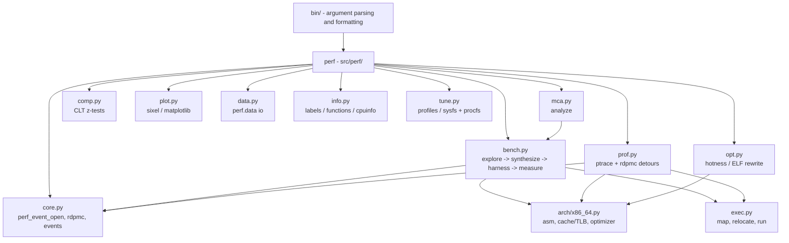

## Architecture

One library, eight commands. Everything a command does is a function in
`src/perf/`, re-exported from `perf`: `import perf` is the whole API. The
`bin/` layer only parses arguments, formats tables, and implements `--json`.



### `benchmark` pipeline

One call expands the config into concrete combinations, measures each, tags
the columns, and concatenates:

1. Expand `config x cache x mode` into combos.
2. `_bench_one` / `_bench_project`: map the ELF, apply relocations, set up the
   stack.
3. `explore`: use angr to find which inputs reach which paths.
4. Synthesize per-iteration register and memory values.
5. `_build_loop_asm`: steering, priming, counters, guard.
6. Assemble, `mmap`, and write `/tmp/perf-pid.map` (opened `O_NOFOLLOW`).
7. `_check_target_runnable`: run once in a throwaway child.
8. `_collect`: overhead harness, then the real one; `_combine_results` indexes
   records by file, name, and mode.

`analyze` follows the same map/explore steps but disassembles instead of
measuring. `profile` patches the running process and uses no harness.
`compare`, `plot`, and `view` only consume the DataFrame the others produced.

### Command responsibilities

| Command | Python entry point | Responsibility |
| --- | --- | --- |
| `benchmark` | `perf.benchmark` | Explore, synthesize inputs, JIT the harness, measure |
| `analyze` | `perf.analyze` | Explore and disassemble; modelled cost, no counters |
| `optimize` | `perf.optimize` | Hotness-guided ELF rewrites |
| `profile` | `perf.profile` | Live `ptrace` + `rdpmc` detours, no harness |
| `compare` | `perf.compare` | CLT z-tests on mean and geometric mean |
| `plot` | `perf.plot` | Sixel/ASCII terminal plots or matplotlib files |
| `view` | CLI only | Reshape and aggregate a DataFrame |
| `system` | `perf.system.info/tune/reset` | CPU info, tuning, stock restore |

#### `benchmark`

- One call is: expand config combinations, run each, tag columns, concatenate.
- `mode` defaults to both `latency` and `throughput`; a list runs each against
  every config combination.
- A latency frame has one row per loop trip; a throughput frame has one row per
  whole-loop sample. Read `cycles/operations` through `perf view`.
- The target is checked in a throwaway child before measuring. A target that
  faults, exits, replaces the process, or never returns is refused by name.
- Non-PIE executables are typically linked at `0x400000`, where the measuring
  process already lives; mapping them is refused instead of overwriting the
  process.

#### `analyze`

- Reuses exploration, then disassembles the target: one row per instruction.
- `latency` / `throughput` come from OSACA, not from a counter. No JIT, no run.
- Default columns: `file`, `name`, `index`, `address`, `encoding`, `size`,
  `latency`, `throughput`, `assembly`, plus every `data.*` state column.
- `event=` selects a different set; `"*"` selects all; an unknown name errors.
- `results=` joins a benchmark or profile frame; `filter=` queries the result.
- The listing covers every instruction the target disassembles to. Exploration
  only supplies state columns, so an unfollowed call cannot truncate it.

#### `optimize`

- Applies measured-data-guided passes to an ELF: `peephole`, `branch`, `layout`,
  `align`.
- Peephole/branch are address-stable; `layout`/`align` remap every reference.
- Peepholes: optimal NOPs, same-size `mov r,r`, `xchg r,r`, `lea r,[r]`,
  `lea r,[r*1]`, `shift r,0`, `movabs` shrinking.
- Branch passes fold and invert conditional branches.
- Reachability filtering keeps embedded data and padding out of rewrites;
  layout rewrites whole functions and fills uncovered `.text` gaps.
- Hotness can come from benchmark, profile, `perf.data`, or analyze frames.
- `opt.py` owns function discovery, hotness aggregation, layout, and fixups for
  rel32 branches, RIP-relative memory, RELA/RELR addends, `.eh_frame`, the
  `.eh_frame_hdr` lookup table, symbol tables, and the entry point.
- Binary with indirect jumps, absolute `.text` addresses, text relocations, or
  exception tables keeps its original layout. Non-PIE skips `layout`/`align`.
  Fixup or verification failure falls back to the original image.
- Output defaults to `EXEC.opt<EXT>` (`a.opt.out`). Passes and layout come from
  `config` (`opt`, `layout.align`, `layout.order`) merged over defaults.
- Result columns: `name,address,new_address,size,new_size,hotness,moved`; pass
  stats and fixup counts are in `attrs`.

#### `profile`

- Starts the program under `ptrace`, patches an `int3` at the entry, and
  redirects tracked addresses to `rdpmc` detours.
- Detours append to a ring buffer shared through a sparse temporary file mapped
  into the child. A hit costs no signal and no syscall in the child.
- Targets are labels, function names, hex addresses, or `begin..end` regions.
  The CLI requires `--filter`; Python defaults `filter` to `main`.
- A label or region endpoint gets a trampoline, so the filter costs nothing per
  instruction.
- `output=` and `buffer_size=` mirror `-o` and `--buffer-size`.

#### `view` / `plot`

- `view` reshapes and aggregates a DataFrame; `plot` draws it.
- Terminal capability is queried once and cached: sixel, else ASCII; otherwise
  matplotlib (Agg to a file when `output=` is set).
- A malformed split/table JSON payload (length mismatch) yields an empty frame.
- `data.*` alias resolution covers register, canonical, and `argN` spellings.

#### `compare`

- CLT z-test on the mean and on the geometric mean; significant only if both
  reject.
- Runs match on `mode` and every `data.*` value, not on benchmark name or
  binary. Different builds and names can be compared.
- Benchmark names carry a `-<8hex>` run-id suffix. Matching strips it only when
  it is exactly 8 hex characters: `func-1a2b3c4d` matches `func`;
  `func-zzzzzzzz` does not.
- Needs at least 30 samples per side. Smaller groups are baseline-only with
  `NaN` (`inconclusive`); a group with no challenger still shows its baseline.
- `diff` is `-` when not significant, else a signed percentage (`-` faster,
  `+` slower). A shown value therefore implies significance.

#### `system`

- `system info --cpu` reports CPU topology from sysfs.
- `system tune` applies `performance` by default: the settings shared by
  `latency` and `throughput`.
- Covered settings: governor, EPP, CPU frequency, turbo/boost (with `turbo_msr`
  fallback), user-space `rdpmc`, SMT, ASLR, NMI/watchdog, NUMA balancing,
  THP/defrag, KSM, swappiness, stat interval, timer migration, perf event
  sample/mlock limits, `perf_event_paranoid`, `kptr_restrict`,
  `sched_autogroup_enabled`, `sched_rt_runtime_us`.
- Also covers IRQ balancing/affinity (including per-IRQ masks), power-supply
  state, `isolcpus`, `rcu_nocbs`, and `nohz_full`.
- `power_supply`, `isolcpus`, `rcu_nocbs`, and `nohz_full` are read-only checks:
  a mismatch is reported as `unsupported`, not written.
- `latency` disables turbo/boost and SMT for low jitter and checks isolation.
  `throughput` keeps turbo/boost and SMT and enables THP. `performance` is the
  shared subset.
- JSON profiles merge over `default`; `--profile.KEY=VALUE` overrides any leaf.
- Python: `perf.system.tune()` applies `performance`;
  `perf.system.tune(profile=..., overrides=..., dry_run=...)` applies or plans
  another profile; `perf.system.reset()` restores stock settings. `tune` and
  `reset` return the per-setting frame (`setting,path,before,after`) the CLI
  formats.
- `perf benchmark FILE --list` (also `perf analyze FILE --list` and
  `perf profile --list -- FILE`) lists `.perf.label` sections from `lib/perf/`
  and functions from `angr.CFGFast`.

# API

All public entry points are re-exported from `perf`; `import perf` is the whole
import. Python takes the same `symbol` / `region` / `asm` / `config` / `data` /
`event` values as the CLI; see [bin/README.md](../bin/README.md) for CLI flags,
`.perfconfig`, events, and the output envelope.

| CLI spelling | Python spelling |
| --- | --- |
| `--env KEY=VALUE` | `env=[...]` |
| `-- ARGS...` | `argv=[...]` |
| `--debug` | `debug=True` |
| `--backend` | `backend=` |
| `--json` | `df.to_json()` |
| `-o` (`plot`, `profile`, `optimize`) | `output=` |
| `--buffer-size` (`profile`) | `buffer_size=` |
| `-f` (`compare`, `plot`, `analyze`) | `filter=` |

Python-only arguments: `results=` (`analyze`), `path=` (`df.to_object`),
`bin=`/`fields=` (`perf.data.samples`), `on=`/`variant=` (`compare`).
`perf view`, interactive sessions (`-i`), and target listing (`--list`) are
CLI-only.

```text
perf.benchmark(symbol=None, region=None, asm=None, name=None, *, mode=None,
               config=None, data=None, event=None, setup=None, teardown=None,
               argv=None, env=None, backend=None, auto_backend=False,
               debug=False)
perf.analyze(symbol=None, region=None, asm=None, name=None, *, event=None,
             results=None, config=None, data=None, setup=None, teardown=None,
             filter=None, debug=False)
perf.profile(cmd, event=None, filter=None, output="profile.json",
             buffer_size=65536)
perf.compare(df, event=None, baseline=None, alpha=0.05, on=None,
             variant=None, filter=None)
perf.optimize(exec=None, output=None, data=None, opt=None, config=None,
              dry_run=False)
perf.plot(df, type=None, event=None, xaxis=None, yaxis=None, groupby=None,
          config=None, output=None, filter=None)
perf.system.info(fields=None)
perf.system.tune(profile=None, *, overrides=None, dry_run=False)
perf.system.reset(*, dry_run=False)
```

- Public API: `benchmark`, `profile`, `analyze`, `compare`, `optimize`, `plot`,
  and `system` (`info`/`tune`/`reset`).
- `perf.benchmark` defaults to both modes like the CLI when `mode=` is omitted.
- `perf.benchmark(auto_backend=True)` downgrades cache-sensitive `unroll`
  combos to `loop`; a collection restricts which cache keys matter.
- `perf.compare` detects the variant column (`name`, `file`, or the data source)
  like the CLI unless `variant=` is given. With no `event=`, it compares every
  measured event per operation. `alpha` defaults to `0.05`.
- `perf.plot` with no `event=` charts `duration_time` when present, otherwise
  every measured event. The CLI defaults to one per-operation chart per event.
- `perf.optimize` takes `exec=`, `output=` (default `EXEC.opt<EXT>`), `data=`,
  `opt=`, `config=`, and `dry_run=`.
- A `benchmark` frame adds `df.to_json()` and `df.to_object()`. Other frames use
  pandas methods.
- `df.to_json()` records `hostname` (`info.hostname()`) alongside `cpu` in its
  `info` section.
- `perf.info.metadata(file)` returns binary metadata; `perf.data.samples(path)`
  returns `perf.data` samples; `perf.info.asm_labels(file)` returns
  `(name, position, size)` tuples; `perf.info.format_hz(hz)` formats
  frequencies.
- `perf.benchmark` dumps every measured sample: latency one row per loop trip
  with its scalar `data.*` input in slot order; throughput one row per
  whole-loop sample. `perf view`, `perf plot`, and `perf compare` read that
  shape as-is.

## `symbol`, `region`, and `asm`

`perf.benchmark` and `perf.analyze` accept:

| Form | Meaning |
| --- | --- |
| `("a.out", "func")` | Function of a binary |
| `("a.out", ("hot_begin", "hot_end"))` | Region of a binary |
| `("foo.s", "foo")` | Label of an assembly source |
| `("foo.s", ("foo", "bar"))` | Region of an assembly source |
| `"a.out:func"` | String shorthand for the pair form |
| `"a.out:hot_begin..hot_end"` | String shorthand for a region |
| `"mov eax, 42"` | Raw asm snippet, no file |

String shorthand also covers `"file:begin..end"`. A raw snippet is Intel
syntax. A bare file is not a target; use `perf benchmark FILE --list` to list
its symbols.

## `argv` and `env`

- `benchmark(argv=..., env=...)` gives the target a process to run as.
- Python `argv` is the full list, including `argv[0]`.
- No `env` means an empty environment (`envp[0] == NULL`), like `env -i`.
- `Elf.setup_argv` writes strings, `argc`, `argv`, `envp`, and an `AT_*`
  auxiliary vector into the mapped stack.
- `arch.argv_asm` puts `argc`/`argv`/`envp` into `rdi`/`rsi`/`rdx` before the
  call and points `rsp` at the image during the loop.
- The stack is laid out like the kernel's: vectors at the stack pointer and
  strings above them, so `getauxval()` answers for the measured image.
- An empty `argv` means `argv[0]` is `file` and `argc` is 1.
- `data.rdi`, `data.rsi`, and `data.rdx` are refused while `argv` is set: the
  ABI already decides those registers.

```py
df = perf.benchmark(
    symbol=("/usr/bin/tree", "main"),
    mode=["latency"],
    argv=["/usr/bin/tree", "/path/to/folder"],
    env=["LANG=C.UTF-8"],
)
```

The CLI spells the same call as
`perf benchmark /usr/bin/tree:main -m latency --env LANG=C.UTF-8 -- /path/to/folder`.
The CLI prepends the program named by `CODE` as `argv[0]` when the first word
after `--` is not already that program.

## `data`

- Accepts flat `{"rdi": 15}` and grouped `{"regs": {...}, "mem": {...}}` forms
  interchangeably.
- Keys are register names, `argN` aliases, or memory addresses.
- Values are scalars or lists; lists are sampled per iteration according to
  `branch`.
- `{"0x4200000000:": "bytes"}` writes a string/byte range;
  `{"0x4200000000": 123}` writes one value. A pointer whose target has no data
  faults, which is reported as such rather than as a wrong number.
- Explicit data constrains exploration and overrides synthesized values.

## `config`

`perf.benchmark(config={...})` takes the same object as `--config`: a JSON file
plus `--config.KEY=VALUE` overrides. It is merged over defaults. A list value
sweeps the cartesian product; a single value runs once. Nested list leaves also
sweep (`branch.regs.rdi`, `backend.loop.runs`, cache/TLB hit rates). `code`,
`stack`, `heap`, and `func` keep their list as alternatives of containers.

| Key | Forms and meaning |
| --- | --- |
| `seed` | Integer or string; a fresh seed is generated when omitted or `null`. |
| `samples` | Samples per series; default `100`. |
| `iterations` | Scalar pins the trip count. Dict is the calibration window `{"min": 100, "max": 1000000}`; leaves may sweep. |
| `backend` | `loop` or `unroll`; a backend options dict such as `{"unroll": {"count": 5}}`; a per-mode map `{"latency": "unroll", "throughput": "loop"}`; or a list of alternatives to sweep. A dict cannot mix mode-name keys and backend-name keys. |
| `backend.<name>.probes` | Calibration runs used to size the trip count; default `3`. |
| `backend.<name>.runs` | Measurement runs; default `10`. Every run is measured. |
| `backend.<name>.target` | Target relative standard error for calibration; default `0.01` (1%). |
| `backend.unroll.count` | Unroll factor; default `5`. The 2N vs N differential divides by N. |
| `branch` | `predictable` / `unpredictable`, bool, dict, or list. Dict keys are `prediction`, `mem` (addresses), `regs` (registers), or direct address/register keys. Leaves may be lists, so one dict can sweep. |
| `dcache` | `hot` / `warm` / `cool` / `cold`; a number (L1d `hit_rate` shorthand); `{"hit_rate": N}`; per-level rates; per-address and per-register overrides. Default sweep: `hot,warm,cool,cold`. |
| `icache` | `hot` / `warm` / `cool` / `cold`; a number or `{"hit_rate": N}`; per-address and per-register overrides. Steers the code's `L1i` data-hierarchy line. Default sweep: `hot,cold`. |
| `dtlb` | `hot` / `warm` / `cool` / `cold`; a number or `{"hit_rate": N}`; per-address and per-register overrides for `TLBd`. Default sweep: `hot,cold`. |
| `itlb` | `hot` / `warm` / `cool` / `cold`; a number or `{"hit_rate": N}`; per-address and per-register overrides for `TLBi`. Default sweep: `hot,cold`. |
| `code` | `[{"align": <power-of-two>}]`; `1` keeps native layout. Default `1,16`. |
| `stack` | `[{"size": "auto" or bytes, "align": "auto" or power-of-two, "mode": "random", "zero", or "fixed"}]`; explicit size is at least 256 bytes. |
| `heap` | `[{"size": "auto" or bytes, "mode": "random", "zero", or "fixed"}]`; explicit size is 8..65536 bytes. |
| `func` | `[{"align": <power-of-two>, "order": "as-is" or "random"}]`. |
| `thread` | List of thread alternatives; each thread is `{"numa": node, "affinity": cpu/list/taskset, "priority": nice/name}`. |
| `external` | `lib`, `stdout`, `stderr`; each a boolean, or a list to sweep. |

Cache/TLB values:

- A numeric cache value is a `hit_rate` shorthand. `{"dcache": 50}` means
  50% L1d and zero L2/L3; `{"dtlb": 50}` means 50% TLBd. A number inside a
  tier slot, e.g. `{"L1d": 50}`, is the same shorthand for that tier.
- A register key applies to the addresses the register points at. `arg0` is the
  first integer argument. `{"dcache": {"L1d": {"arg0": "cold"}}}` flushes the
  touched memory in the first argument's 4 KiB window.
- Register and address overrides also work under `icache`, `dtlb`, and `itlb`.
  Explicit address levels win over register levels.
- `L1d`, `L2`, and `L3` are `dcache` level keys. `L1i`, `TLBd`, and `TLBi` are
  internal tier names: for `icache`, `dtlb`, and `itlb` use a shortcut, a
  number, `hit_rate`, or a per-address/per-register entry.

`stack.mode` and `heap.mode`:

- `"random"` (default): fresh random contents before every measured call.
- `"zero"`: zeros before every measured call.
- `"fixed"`: initialize once, then leave the contents alone so the target can
  mutate them.
- `mode` is the only preparation key; there is no `init` field.
- Random/zero refresh happens outside the timed region in latency mode.
- For binary targets in latency mode, `stack.mode` also switches the measured
  call to the harness stack and refreshes a small top window (1 KiB; per-run
  buffer capped at 4 MiB for large trip counts).
- Asm snippets run on the process stack: `stack.mode` controls only their
  symbolic-exploration stack. Throughput measurements also keep the process
  stack.

Example:

```json
{
  "seed": 123,
  "samples": 100,
  "iterations": {"min": 100, "max": 1000000},
  "backend": {"latency": "unroll", "throughput": "loop"},
  "branch": {
    "prediction": "predictable",
    "regs": {"rdi": ["predictable", "unpredictable"]},
    "mem": {"0x1000": "predictable"}
  },
  "dcache": [
    "hot",
    {"L1d": {"hit_rate": 100}, "L2": 50},
    {"L1d": {"arg0": "cold"}},
    50
  ],
  "icache": ["hot", {"hit_rate": 50}],
  "dtlb": ["hot", {"hit_rate": 50}],
  "itlb": ["hot", {"hit_rate": 100, "0x401000": "hot"}],
  "code": [{"align": 1}, {"align": 32}],
  "stack": [{"size": "auto", "align": "auto", "mode": "random"}],
  "heap": [{"size": 8192, "mode": "fixed"}],
  "func": [{"align": 16, "order": "as-is"}],
  "thread": [[{"numa": 0, "affinity": 0, "priority": "normal"}]],
  "external": {"lib": false, "stdout": false, "stderr": false}
}
```

To sweep backends instead of selecting one per mode, use
`config={"backend": ["loop", "unroll"]}`. A backend option leaf sweeps too,
e.g. `config={"backend": {"loop": {"runs": [3, 5]}}}`. The list form is read
from `config`; the `backend=` argument takes a name or per-mode map.

## Synopsis

```py
import perf

# benchmark: mode is a list; event/config/data mirror the CLI flags
df = perf.benchmark(symbol=("a.out", "func"), mode=["latency"], event=["duration_time"])
df = perf.benchmark(
    region=("a.out", ("hot_begin", "hot_end")),
    mode=["latency"],
    event=["topdown-*"],
    data={"regs": {"rdi": 15}},
)
df = perf.benchmark(
    symbol=("/usr/bin/tree", "main"),
    mode=["latency"],
    argv=["/usr/bin/tree", "/path/to/folder"],
    env=["LANG=C.UTF-8"],
)
df = perf.benchmark(asm="mov eax, 42", mode=["latency"], event=["cycles"])
df = perf.benchmark(symbol=("a.s", "myfunc"), mode=["latency"])
df = perf.benchmark(region=("foo.s", ("foo", "bar")), mode=["latency"])
df = perf.benchmark(
    symbol=("a.out", "func"),
    mode=["latency", "throughput"],
    config={
        "dcache": ["hot", "cold"],
        "branch": {"prediction": "predictable"},
        "backend": {"latency": "unroll", "throughput": "loop"},
    },
)
df = perf.benchmark(
    asm="mov rax, [rdi]",
    mode=["latency"],
    config={
        "code": [{"align": 1}, {"align": 32}],
        "thread": [[{"numa": 0, "affinity": 1, "priority": "normal"}]],
        "dcache": {"L1d": {"arg0": "cold"}},
    },
)

# per-instruction analysis: index 0..n, one row per instruction
df = perf.analyze(symbol=("a.out", "func"))
df = perf.analyze(region=("foo.s", ("foo", "bar")))
df = perf.analyze(
    region=("a.out", ("hot_begin", "hot_end")),
    event=["assembly", "encoding"],
)
df = perf.analyze(symbol=("a.out", "func"), event=["data*"])
df = perf.analyze(symbol=("a.out", "func"), event=["*"])
df = perf.analyze(symbol=("a.out", "func"), filter="latency > 4")
df = perf.analyze(asm="mov rax, rdi", results=df)
df = perf.analyze(symbol=("a.out", "func"), data={"regs": {"rdi": 15}})
df = perf.analyze(symbol=("a.out", "func"), filter="15 in `data.rdi`")
df = perf.analyze(symbol=("a.out", "func"), setup="a.out:start", teardown="a.out:stop")

# binary optimization (benchmark/profile/perf.data/analyze guide hot layout)
df = perf.optimize(exec="a.out", output="b.out", data=["data/"])
df = perf.optimize(exec="a.out", output="b.out", opt=["peephole", "branch"])
df = perf.optimize(
    exec="a.out",
    output="b.out",
    config={"opt": ["layout"], "layout": {"align": 64}},
)

# metadata and perf.data
print(perf.info.asm_labels("foo.s"))
print(perf.info.metadata("a.out"))
print(perf.data.samples("perf.data"))

# relocatable object of the measured target and JSON envelope
df = perf.benchmark(symbol=("a.out", "func"), mode=["latency"])
path = df.to_object(path="bench.o")
json = df.to_json(indent=4)

# binary/cpu metadata
cpu = perf.system.info()
print(perf.info.format_hz(cpu["freq"].iloc[0]))

# live profiling: labels, functions, hex addresses, or (begin, end) regions
df = perf.profile(cmd=["./a.out"], event=["cycles"], filter=["hot"])
df = perf.profile(cmd=["./a.out"], event=["cycles"], filter=["func"])
df = perf.profile(
    cmd=["./a.out"], event=["cycles"], filter=[("work_begin", "work_end")]
)

# compare and plot
cmp = perf.compare(df, baseline="base")
perf.plot(df, type=["ecdf"], event=["cycles"])
```

# Examples

The commands below target x86-64 Linux. Hardware and hardware-cache events need
user-space `rdpmc`; `duration_time` works without it. Run IDs and exact rows
vary between machines.

```sh
git clone https://github.com/perf-labs/perf.git && cd perf
pip install -e .
mkdir -p /tmp/work && cd /tmp/work
cp -r ~/perf/lib .          # zero-instruction PERF_LABEL markers
```

```c
// fizz.c
#include "perf/perf.h"

int hot(int n) {
    PERF_LABEL(hot_begin);
    int s = 0;
    for (int i = 0; i < n; ++i) s += i;
    PERF_LABEL(hot_end);
    return s;
}

int main(void) { return hot(10); }
```

```sh
gcc -O2 -I lib -o fizz fizz.c
```

## Function, region, snippet, sweep

```sh
perf benchmark fizz --list | head        # labels and functions with addresses
perf benchmark fizz:hot -m latency -e cycles --data.arg0=10
perf benchmark 'fizz:hot_begin..hot_end' -m latency -e cycles --data.arg0=10
perf benchmark 'imul eax, 0' -m latency -e cycles,instructions
perf benchmark fizz:hot -m latency -e cycles --data.arg0=[1,3,5,10]
```

- `--data.arg0=15` is `rdi`, the first integer argument. `arg0`/`arg1`/... are
  the System V argument registers.
- A latency run reports one row per trip; aggregate with `perf view`.
- A bracketed comma-separated value sweeps inputs in one run.

## Shared libraries, programs, C++

```sh
LIBC=/usr/lib/x86_64-linux-gnu/libc.so.6
perf benchmark "$LIBC" --list
perf benchmark "$LIBC:strlen" -m latency -e cycles \
    --data.rdi=0x4200000000 --data[0x4200000000:]=hello

perf benchmark /usr/bin/ls:main -m latency -e cycles -- /tmp/work
perf benchmark /usr/bin/tree:main -m latency --env LC_ALL=C -- /home
```

- An indirect function resolves to the implementation the loader picked for
  this CPU.
- Pass a shared library's symbol by its demangled/exported name; version
  suffixes such as `@@GLIBCXX_3.4` are not part of the name.
- `main` must be callable on its own. `ls`, `id`, and `tree` return; `cat`
  blocks; a null-dereferencing target faults. The runnable check refuses those
  before measuring.
- A member function needs `this` in `rdi` and its fields in memory. Use `--setup`
  / `--teardown` to restore globals:
  `--data.rdi=0x42000000000 --data[0x42000000000:]=1`.
- Non-PIE system binaries (for example `/usr/bin/gcc`) cannot be mapped at
  `0x400000`. The run stops with the reason; `--list` still works.
- A program's own arguments go after `--`. The program named by `CODE` is
  prepended as `argv[0]` unless the first word already equals it.

## Analyze, profile, compare

```sh
perf analyze fizz:hot --data.arg0=10 -e assembly,latency,throughput
perf analyze fizz:hot --data.arg0=10 --filter 'latency > 0'
perf analyze fizz:hot --data.arg0=10   # default columns include encoding/data.*

perf benchmark fizz:hot -m latency -e cycles -o data/
perf profile -f hot -e cycles -o profile.json -- ./fizz
perf analyze fizz:hot -- profile.json  # join measured per-ip counts

perf benchmark a.old:func -n base -m latency -e cycles -o old/
perf benchmark a.new:func -n cand -m latency -e cycles -o new/
perf compare -b base -- old/ new/
```

- `perf analyze` never runs the target. `latency`/`throughput` are modelled.
- `perf profile` needs `--filter`; a label or region endpoint gets a trampoline.
- `perf compare` calls a difference significant only when both z-tests reject.
  `-b` takes the name recorded by `perf benchmark -n`.

## View, plot, top-down, cache sweep

```sh
perf view -s min,median,p99 -- data/
perf plot -t ecdf -e cycles -o plot.png -- data/
perf plot --config.backend=window -e cycles -- data/
perf plot -e cycles -- data/            # sixel/ascii by terminal capability

perf benchmark fizz:hot -m latency -e 'topdown-*' --data.arg0=10 \
    --config.samples=1

perf benchmark fizz:hot -m latency -e cycles --config.dcache=hot,warm,cool,cold
perf benchmark fizz:hot -m latency -e cycles \
    --config.branch=predictable,unpredictable
```

- `topdown-*` expands to the four slots and normalizes them to percentages;
  an unavailable slot stays empty. The window includes the harness, so read it
  as whole-loop attribution.
- Top-down slots exist only on Intel CPUs that have them; elsewhere the run
  stops with a reason. On hybrid CPUs a dropped slot comes back empty, meaning
  "not measured", not zero. Measuring the slots one at a time with repeated
  `-e` always works.
- The `config.*` columns say which alternative each row is.

Python equivalents are in [Synopsis](#synopsis); see
[bin/README.md](../bin/README.md) for every flag.

# How it works

## 1. A harness around the target

`perf benchmark` JITs a loop around the measured snippet. `latency`
times one call per iteration, `throughput` times the whole loop.
`r8` is the trip count, `r9` is retained for ABI compatibility but is no
longer read by the loop, `r10` is the output cursor, and `{t0}`/`{t1}` are
the counter reads. `rdi` is zeroed before `{setup}` so the target does not
inherit the harness argument pointer. Per-iteration data registers are
reloaded from the per-iteration buffer after `{t0}`. The prologue keeps `rsp` 16-byte aligned
so the `call` into the target is ABI-correct
(`src/perf/arch/x86_64.py: _BENCH`):

```asm
; latency: per-iteration sample
mov r8, [rdi]                 ; iterations
.perfloop:
    ; {data}  steer: values + cache/TLB tier for this iteration
    ; {data2} prime: regs for this iteration (after t0, see below)
    ; {t0}    counter prologue (below)
    ; {code}  guard + call rax (+ lfence) / raw asm snippet
    ; {t1}    counter epilogue (below)
    dec r8
    jnz .perfloop

; throughput: one sample for the whole loop
    ; {data}  steer once
    ; {data2} explicit register reload
    ; {t0}
.perfloop:
    ; {data_iter} values + regs per iteration
    ; {code}
    dec r8
    jnz .perfloop
    ; {t1}
```

Example — what you ask vs what runs:

```sh
perf benchmark a.out:func -m latency -e cycles
# -> latency loop above, {code} = guard + call func, timed per iteration

perf benchmark a.out:func -m throughput -e cycles
# -> throughput loop above, one sample for all iterations

perf benchmark 'imul eax, 0' -m latency
# -> same loops, {code} = the raw snippet (no call)
```

Only the target's own instructions are ever reported. `perf analyze`
disassembles the target itself, never the harness, and the harness's own
timing reads, cache/TLB steering, register priming and call sequence are
subtracted by the differential rather than attributed to the target. The one
harness instruction deliberately inside the measured window is the per-iteration
register priming (`{data2}` in latency, `{data_iter}` in throughput): it has to
run after `rdtsc`/`rdpmc`, which clobber `rax` and `rdx`, so that the target
sees its inputs. It is identical in the `nop` baseline, so it cancels.

For `unroll`, labels are renamed per copy (`<label>__unroll<N>`), including
inline labels written after `;`, so labeled snippets assemble.

## 2. Counters without syscalls, overhead subtracted

Counter reads (`timing()`) need no syscall — `duration_time` uses
`rdtsc`/`rdtscp`, everything else uses `rdpmc` (needs
`perf system tune --profile=latency` once):

```asm
; t0 (duration_time, single event; baseline kept in r11, r10 = output cursor)
push rcx
lfence
rdtsc
shl rdx, 32
or rax, rdx                ; full 64-bit TSC, low half alone wraps quickly
mov r11, rax
lfence
pop rcx
; t1
push rcx
rdtscp
shl rdx, 32
or rax, rdx
lfence
sub rax, r11               ; delta
mov [r10], rax
add r10, 8
pop rcx
; rdpmc events: same shape with `mov ecx, <pmc-index> + lfence + rdpmc + lfence`
; (the read is ordered before and after the window; `rdpmc` alone is only
;  ordered against other counter reads)
; multi-event: one baseline reg per event, `mov [r10+8*i], rax` + `add r10, 8*N`
```

Overhead is subtracted differentially: `loop` measures a `nop`
(`call_seq_nop_asm` for functions) and subtracts its minimum; `unroll`
measures N vs 2N copies (`backend.unroll.count`, default `5`) and divides by
N. Zero deltas are kept, only negative ones stay missing. When every run is
below overhead the fallback reports the overhead-corrected minimum clamped
to zero with a warning, never the raw count. Counter indices are refreshed
from the kernel before each phase, never reused blindly. Trip count
auto-calibrates (`iterations.min/max`, default `100/1000000`)
to a target relative standard error (`backend.<name>.target`, default
`0.01`, i.e. 1%) unless `iterations` is pinned (a scalar). Calibration runs
size the trip count; the measurement itself still uses every
`backend.<name>.runs` run.
Timing events report their minimum and count events their mean. `unpredictable`
branch runs draw a fresh random input sequence for every run and report means,
so the branch predictor cannot learn a sequence replayed across runs and
mispredictions are not cancelled by the unroll differential. The resolved
backend and the options it ran with are written back into `backend`, keyed by
the backend name (`{"loop": {...}}`), so the `output` rows carry them.
`backend` may also be a per-mode map
(`backend={"latency": "unroll", "throughput": "loop"}`) or a list to
sweep; an explicit `backend=`/`config.backend` wins.

Cache/TLB steering runs once per loop iteration. A latency snippet that
explicitly asks for a non-resident tier therefore defaults to `loop` instead of
`unroll`: the N/2N differential only steers the first copy, so the extra copies
hit the line the first one fetched and the requested miss is cancelled. The
default data-cache/TLB sweep applies this per combination, so `dcache`/`dtlb`
non-resident combinations use `loop` while hot ones keep `unroll`; default
`icache`/`itlb` alternatives keep `unroll` unless set explicitly. Pin every
steered tier to `hot`, or pass `--backend unroll` explicitly, to use `unroll`
for the whole run.

Example — check what the harness did:

```sh
perf benchmark a.out:func --debug 2>&1 | head -50
# prints config, found solutions, synthesized data, full asm, per-run rows

perf benchmark a.out:func --config.iterations=1000
# pin the trip count instead of auto-calibrating

perf benchmark 'rdtsc' -m latency --backend unroll
```

Each run is wrapped in the placement guards of `thread` — `_numa_guard`
(`set_mempolicy(MPOL_BIND, node)`, best effort), `_affinity_guard`
(`sched_setaffinity`) and `_priority_guard` (nice) — which restore whatever
the process had before once the runs are done.

```sh
perf benchmark a.out:func --config.thread.affinity=2  # pin to cpu 2
perf benchmark a.out:func --config.thread.numa=1       # bind memory to node 1
```

## 3. Inputs are discovered, not guessed

Before measuring, `bench` discovers what to feed the snippet:

Symbolic exploration (`src/perf/bench.py: explore`): the target (function, `(begin, end)` region, or `asm`
snippet) is lifted to VEX IR and explored with `angr`. Functions use
`call_state` so the ABI prototype is honored, anything else uses
`blank_state` plus a mapped stack (`stack.size/align/mode`); `--setup` asm is
assembled at `_SETUP_BASE` (`0x1000000`) and prepended as a jump stub to the
target. All general purpose registers start as symbolic (`claripy.BVS`),
explicit `--data` scalar registers are constrained (`== value`; list values
stay symbolic and are sampled later), explicit `--data` pages are mapped,
and every memory read/write is recorded with `mem_read`/`mem_write`
breakpoints. Exploration runs `simgr.explore(find=ret_addrs)` (every `ret`
in the function, else the region/snippet end), so one run covers every code
path. Raw `asm` goes through the same path via `explore_asm`: the snippet
is assembled at `_SETUP_BASE`, unknown registers are pinned to scratch
pages (`_ASM_SCRATCH_BASE 0x4100001000 + idx*0x1000`) so pointer derefs do
not fault, and `find=[base+len(encoding)]`.

Low-level example — this snippet has two paths. Exploration finds both
`ret`s, so one benchmark run covers both branches automatically:

```asm
cmp edi, 0
jle .else
mov eax, 1
ret
.else:
mov eax, 2
ret
```

```py
# conceptually what explore() sets up (src/perf/bench.py:explore)
state.registers.store("rdi", claripy.BVS("rdi", 64))  # every GPR symbolic
state.inspect.b("mem_read", when=BP_AFTER, action=record)  # same for mem_write
simgr.explore(find=[ret1, ret2])  # both rets
# found[0] constraints: rdi > 0,  bbl_addrs: [entry, .then]
# found[1] constraints: rdi <= 0, bbl_addrs: [entry, .else]
```

Solving (`solve()`): each found state is solved with the SMT solver.
Registers and every recorded `(addr_sym, length_sym, value_sym)` are
`solver.eval`'d to concrete models; a symbolic return value (`If`-tree over
`BVV` leaves) forks the state once per leaf. For
`branch.*.mem = predictable` addresses the solver also records
`branch_deps` (which registers/memory each conditional branch consumes via
`cond_branch_analysis`), so predictable runs can pin exactly those inputs.

Continuing the example:

```py
solver.eval(found[0].regs["rdi"])  # -> 1,  constraint rdi > 0
solver.eval(found[1].regs["rdi"])  # -> 0,  constraint rdi <= 0
models = [
    {"regs": {"rdi": 1}, "reads": [], "writes": []},
    {"regs": {"rdi": 0}, "reads": [], "writes": []},
]
```

`perf analyze` reports the same states: `data.<reg>` is the solved value of
each register a state pins (its `inputs`, i.e. the registers the target is
given rather than the ones the exploration had to pin to keep going) and
`data.<addr>` the value a state has at an address it read or wrote, keyed by
the instruction address. The per-instruction `accesses` recorded alongside
`reads`/`writes` (address, instruction, load or store) are what makes that
mapping possible without a second exploration. Without `event`, `analyze`
returns `file,name,index,address,encoding,size,latency,throughput,assembly`
plus every `data*` column; pass `event` to pick any other set (`"*"` for
all of them, a name that is not there is an error). The rows are every
instruction the target disassembles to; the exploration only supplies the
state columns, so a call the emulator cannot follow never cuts the listing
short half way through a function.

With memory, `mov rax, [rdi]` records one read; solving yields a concrete
address/value pair, e.g. `reads: [(0x4100001000, 8, 123)]` where
`0x4100001000` is the pinned scratch page for the symbolic `rdi`.

Try it — constrain the explored state yourself:

```sh
# default: both paths sampled automatically
perf benchmark a.out:func -m latency -e cycles

# pin one input: only that state is explored/measured
perf benchmark a.out:func --data.rdi=15 -m latency -e cycles

# sweep three inputs in one run (one measurement per value set)
perf benchmark a.out:func --data.rdi=[1,3,5] -m latency -e cycles
perf analyze a.out:func --data.rdi=15
```

VEX: the executed basic-block addresses (`bbl_addrs` history, plus the block
each state stopped in) select the measured code. Static tables are found
by scanning RIP-relative/displacement operands in the range and keeping
the ones the exploration recorded as *data* (`_static_table_addrs`): a
memory access performed by the very instruction that also exits the block
is a `jmp`/`call` target table, not data, so jump tables stay out of the
cache model and the harness never writes over them.
Data synthesis (`_per_iter_data`): models become a per-iteration table (`_per_iter_data`: one
row per register, plus one value row per address, `K = max(iterations+1,
2*addresses)` columns indexed backwards as `r8 = iterations - it`). Each
iteration picks one model — round-robin (`it % n`) when `predictable`,
`rng.randrange(n)` when `unpredictable` — overlays explicit
`--data.rdi` / `--data[addr]` values, and the harness reads the table via
`prime`/`steer` asm. With no `--data`, sampling cycles through all
paths/values, so branches are covered automatically. When one model and
only scalar data are in play the table is filled in one vectorized pass
instead of per iteration. Each explored state is replayed once before
measuring; a state whose data does not come back is dropped rather than
hanging the harness. If every state fails, empty versions of the same
addresses are tried. Explicit `data` and `setup` win.

```asm
; prime_asm: regs for this iteration (r8 = iterations - it)
push r14
movabs r14, 0x...            ; base of the rdi column
mov rdi, [r14 + r8*8]
pop r14

; _value_write_loop: memory values for this iteration
xor r15, r15
.perfwrite:
    movabs r14, 0x...        ; evict-table: target addresses
    mov r12, [r14 + r15*8]
    movabs r14, 0x...        ; evict-table: value-column pointers
    mov r14, [r14 + r15*8]
    mov r13, [r14 + r8*8]    ; value for iteration r8
    mov [r12], r13
.perfwritedone:
    inc r15
    cmp r15, 0x2
    jne .perfwrite
```

## 4. Cache, TLB and branch state per iteration

Cache eviction (`evict()`): every address gets a tier per iteration (`L1d`/`L2`/`L3`/
`DRAM`, plus `L1i` and `TLBd`/`TLBi`). `hot` keeps everything in `L1`,
`cold` flushes to `DRAM`; per-tier hit rates or per-address levels split
addresses across tiers. `steer_asm` writes the values first, then emits
(`evict()`):

```asm
mov rax, [0x...]             ; L1d: touch + fence (stays resident)
mfence
mov r12, 0x...               ; L2: flush, fence, prefetch into L2
clflushopt [r12]
mfence
prefetcht1 [r12]
mov r12, 0x...               ; L3: flush, fence, prefetch into L3
clflushopt [r12]             ; (cldemote when the CPU has it)
mfence
prefetcht2 [r12]
mov r12, 0x...               ; DRAM: flush only
clflushopt [r12]
mfence
; 16x pause                  ; settle
```

Example — one target, two opposite memory worlds:

```sh
# everything served from L1
perf benchmark 'mov rax, [rdi]' --config.dcache=hot -e cache-misses,cycles

# same code, flushed to DRAM every iteration
perf benchmark 'mov rax, [rdi]' --config.dcache=cold -e cache-misses,cycles

# compare L2 vs L3 residency
perf benchmark a.out:func --config.dcache=warm,cool -e cycles
```

The `TLBd`/`TLBi` tiers are orthogonal to the cache tier of the same
address, so an address can be `L1d` hot and `TLBd` cold at the same time
and gets both the cache op and a ring-3 `mprotect` protection toggle (a
non-privileged `invlpg` alternative, `tlb_inval_asm`):

```asm
mov rdi, 0x...               ; page base
mov rsi, 0x2000              ; 2 adjacent pages
mov rdx, 0x7                 ; PROT_RWX
mov rax, r8                  ; the loop counter
and rax, 1                   ; its parity flips the protection ...
shl rax, 1                   ; ... by 2 for code pages, by 4 for data
sub rdx, rax                 ; PROT_RWX <-> PROT_RX / PROT_RW
mov rax, 10                  ; __NR_mprotect
syscall
```

One syscall per iteration, not a `PROT_NONE`/`PROT_RWX` pair, and the
protection the loop counter selects alternates on its own: the page stays
present, readable and writable in both states (code pages drop `PROT_W`,
data pages drop `PROT_X`), so the target only pays the page walk it was
asked to measure. Both ends of the pair must change the pte or the kernel
makes `mprotect` a no-op and the translation is never dropped, so the two
protections differ in exactly one bit and the shift is that bit's index.
Every page within 64 pages of each other (up to 512 pages per
call) is coalesced into one `mprotect` range, and the harness maps those
ranges up front as one mapping each, so a target that touches many pages
pays one syscall per cluster instead of one per page. A range never covers
a page the harness does not own (a code page steered with a different
protection, or a page that is already taken), the whole block shares a
single push/pop prologue, and the harness restores `PROT_RWX` on every
steered page once the loop is done.

`dtlb` applies to the addresses the target loads/stores and `itlb` to the
pages its code lives at (as does `icache`, via the code's data-hierarchy
line). Both take a global rate (`"hot"` or
`{"hit_rate": 50}`) and, per address or register, a rate of their own
(`{"dtlb": {"0x42000000000": {"hit_rate": 0}}}`) on top of it — the tier
names are the internal ones and are not config keys. A numeric value is a
`hit_rate` shorthand: `{"dcache": 50}` is 50% L1d and zero L2/L3, and
`{"dtlb": 50}` is 50% TLBd. Direct address/register entries and the
`mem`/`regs` sections are equivalent ways to target one input.

Branch data (`branch`): selects predictability globally or per `regs`/`mem`
entry, and takes exactly two values. `predictable` replays models/values in
order (`vals[it % len(vals)]`) and pins branch dependencies, so the target
sees the sequence it was solved with; `unpredictable` samples an index at
random, so the same binary measures both best-case and branch-miss-heavy
behavior without changing code. Dict leaves may be lists to sweep.

```sh
# best case vs branch-miss-heavy, same binary
perf benchmark a.out:func --config.branch=predictable,unpredictable \
  -e cycles,branch-misses
```

## 5. Live profiling without a harness

`perf profile` (`src/perf/prof.py`) patches each tracked address with a 5-byte direct jump to a
trampoline that claims a slot in a shared per-process ring buffer and records
the counter deltas. Every trampoline reserves the 128-byte red zone first,
so pushes never overwrite live leaf stack data. A label detour looks like this:

```asm
sub rsp, 128                    ; reserve the red zone
pushfq                          ; keep flags out of the measured path
push rax
push rcx
push rdx
push r11
mov  r11, <ring_base>
mov  rax, [r11 + 8]             ; head
mov  rcx, rax
and  rcx, <cap_mask>
shl  rcx, <slot-stride-log2>    ; byte offset of the slot
lea  rdx, [rax + 1]             ; reserve slot
mov  [r11 + 8], rdx
lea  r11, [r11 + rcx + 64]      ; slot address (64-byte header at buf start)
mov  dword ptr [r11], <point_id>
mov  qword ptr [r11 + 8], rax   ; sequence number
lfence
mov  ecx, <pmc-index>
rdpmc                           ; raw counter (or rdtsc for duration_time)
shl  rdx, 32
or   rax, rdx
mov  [r11 + 16], rax
pop  r11
pop  rdx
pop  rcx
pop  rax
popfq
add rsp, 128
; <relocated original instructions>
jmp  <resume address>
```

The overwritten instructions are disassembled, relocated (rip-relative
operands fixed up, short branches expanded to their rel32 forms), and emitted
between the recording block and the jump back, so the process resumes
exactly where it left off. Function entry patches additionally push the real
return address onto a per-thread shadow stack indexed by the TLS thread id
and rewrite the saved slot with the trampoline's exit stub, so every `ret`
is intercepted by one patch even when threads overlap. The 1 MiB trampoline
cave is mapped within 1 GiB (`2^30` bytes) of the binary; the original file
on disk is untouched.

Example — profile, then attribute:

```sh
perf benchmark a.out --list                 # what can be tracked
perf profile -f func -e cycles -- ./a.out # one function, live
perf profile -f hot -e 'topdown-*' -- ./a.out # where is it bound?
perf analyze a.out:func -- profile.json   # join counts onto instructions
```
