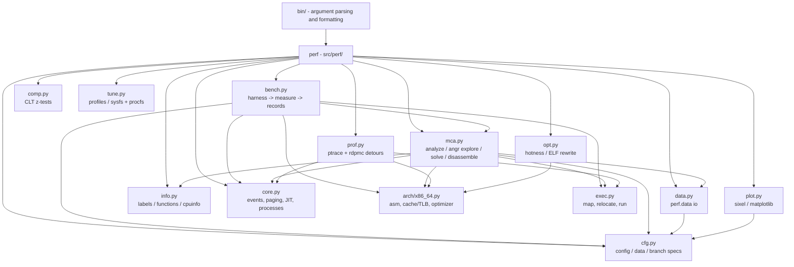

## Architecture

One library, eight commands. Most command behavior lives in `src/perf/` and is
re-exported from `perf`: `import perf` is the public API. The `bin/` layer parses
arguments, formats tables, and implements `--output`.



`cfg.py` owns the benchmark defaults, validation, config expansion, thread and
external configuration, and data/branch synthesis shared by the commands;
`mca.py` owns symbolic exploration, solving and disassembly; `core.py` owns the
event, paging, JIT and process primitives. `bench.py` keeps the public benchmark
pipeline, harness and measurement code.

### `benchmark` pipeline

1. Expand `config x cache x mode` into combinations.
2. Map the ELF, apply relocations, and lay out the stack.
3. `explore`: use `angr` to find inputs that reach each path.
4. Synthesize per-iteration register and memory values.
5. Build the harness loop: steering, priming, counters, guard.
6. Assemble, map, and write `/tmp/perf-pid.map` (opened `O_NOFOLLOW`).
7. Run the target once in a throwaway child. Refuse it if it faults, exits,
   replaces the process, or never returns.
8. Collect the overhead baseline and the real runs, then combine records.

`analyze` reuses exploration but disassembles instead of measuring. `profile`
patches the running process and uses no harness. `compare`, `plot`, and `view`
consume the DataFrame the other commands produce.

### Command responsibilities

| Command     | Python entry point | Responsibility                                                         |
| ----------- | ------------------ | ---------------------------------------------------------------------- |
| `benchmark` | `perf.benchmark`   | Explore, synthesize inputs, JIT the harness, measure                   |
| `analyze`   | `perf.analyze`     | Explore and disassemble; modelled cost, no counters                    |
| `optimize`  | `perf.optimize`    | Hotness-guided ELF rewrites                                            |
| `profile`   | `perf.profile`     | Live `ptrace` + `rdpmc` detours, no harness                            |
| `compare`   | `perf.compare`     | CLT z-tests on mean and geometric mean                                 |
| `plot`      | `perf.plot`        | Sixel/ASCII terminal plots or matplotlib files                         |
| `view`      | CLI only           | Reshape and aggregate a DataFrame                                      |
| `system`    | `perf.system.*`    | CPU info, tuning status, tuning, snapshot restore, known-answer checks |

### Per-command notes

#### `benchmark`

- `mode` defaults to both `latency` and `throughput`; each is measured against
  every config combination.
- A latency frame has one row per loop trip. A throughput frame has one row per
  sample, the minimum of `backend.<name>.runs` whole-loop runs. Read
  `cycles/operations` through `perf view`.
- A target that cannot observe an axis is pruned before measuring: no
  conditional branches drops `branch` sweeps; no data-memory accesses drops
  `dcache`/`dtlb` sweeps. Explicit `data` and model memory keep them.
- Non-PIE executables are typically linked at `0x400000`, where the measuring
  process already lives; mapping them is refused instead of overwriting the
  process.

#### `analyze`

- Reuses exploration, then disassembles the target: one row per instruction.
- `latency` / `throughput` come from OSACA, not from a counter. No JIT, no run.
- Default columns: `file`, `name`, `index`, `address`, `encoding`, `size`,
  `latency`, `throughput`, `assembly`, every `data.*` state column, and all
  joined counters. `index` comes first.
- `event=` selects a different set; `"*"` selects all; an unknown name errors.
- `args=` joins a benchmark or profile frame; `filter=` queries the result.
- `debug=True` interleaves DWARF source lines; `decompile=True` interleaves
  angr decompiler pseudocode (`CFGFast(normalize=True)` + `Decompiler`). The
  full text is also in `df.attrs["decompile"]`.
- The listing covers every instruction the target disassembles to. Exploration
  only supplies state columns, so an unfollowed call cannot truncate it.

#### `optimize`

- Applies measured-data-guided passes to an ELF: `peephole`, `branch`, `layout`,
  `align`. Data is required (`data=` in Python, `DATA` after `--` on the CLI);
  missing or unusable data raises an error.
- Peephole/branch are address-stable; `layout`/`align` remap every reference.
- Peepholes: optimal NOPs, same-size `mov r,r`, `xchg r,r`, `lea r,[r]`,
  `lea r,[r*1]`, `shift r,0`, `movabs` shrinking.
- Branch passes fold and invert conditional branches.
- Reachability filtering keeps embedded data and padding out of rewrites;
  layout rewrites whole functions and fills uncovered `.text` gaps.
- Hotness can come from benchmark, profile, `perf.data`, or analyze frames.
- `opt.py` owns function discovery, hotness aggregation, layout, and fixups for
  rel32 branches, RIP-relative memory, RELA/RELR addends, `.eh_frame`, the
  `.eh_frame_hdr` lookup table, symbol tables, and the entry point.
- Binary with indirect jumps, absolute `.text` addresses, text relocations, or
  exception tables keeps its original layout. Non-PIE skips `layout`/`align`.
  Fixup or verification failure falls back to the original image.
- Output defaults to `EXEC.opt<EXT>` (`a.opt.out`). Passes and layout come from
  `config` (`opt`, `layout.align`, `layout.order`) merged over defaults.
- Result columns: `name,address,new_address,size,new_size,hotness,moved`; pass
  stats and fixup counts are in `attrs`.

#### `profile`

- Starts the program under `ptrace`, patches an `int3` at the entry, and
  redirects tracked addresses to `rdpmc` detours.
- Detours append to a ring buffer shared through a sparse temporary file mapped
  into the child. A hit costs no signal and no syscall in the child.
- Targets are labels, function names, hex addresses, or `begin..end` regions.
  The CLI requires `--filter`; Python defaults `filter` to `main`.
- A label or region endpoint gets a trampoline, so the filter costs nothing per
  instruction.
- `output=` and `buffer_size=` mirror `--output` and `--buffer-size`.
  `output=` accepts the same repeatable destinations; without it no file is
  written and the CLI prints the table.

#### `view` / `plot`

- `view` reshapes and aggregates a DataFrame; `plot` draws it.
- Terminal capability is queried once and cached: sixel, else ASCII; otherwise
  matplotlib (Agg to a file when `output=` is set).
- A malformed split/table JSON payload (length mismatch) yields an empty frame.
- `data.*` alias resolution covers register, canonical, and `argN` spellings.
- `type=["cfg"]` draws a CFG from analyze instruction rows; a binary path uses
  `CFGFast(normalize=True)`, or `CFGEmulated(keep_state=True)` with
  `config={"cfg": "emulated"}` (`dynamic`, `emu`, `cfgemulated`, `cfg-emulated`,
  `cfg_emulated` are accepted as `emulated`). `df.attrs["flow_graph"]` supplies
  a ready graph. `config.cfg` applies to binaries only; row-derived graphs are
  always static.
- `type=["auto"]` is the default (also settable as `[plot] type = auto` in
  `.perfconfig`) and picks the chart from the data: analyze/disassembly
  rows and flow graphs use `cfg`, an explicit multi-value `xaxis` uses `line`, and
  benchmark or profile samples use `ecdf`. An explicit `-t`/`type=` overrides the
  automatic choice.

#### `compare`

- CLT z-test on the mean and on the geometric mean. When both p-values are
  finite, both must reject; the verdict is significant only if the combined
  `p = max(p_mean, p_gmean) < alpha`. If the log test is undefined, the finite
  test alone decides.
- Runs match on `mode` and every `data.*` value, not on benchmark name or
  binary. Different builds and names can be compared.
- Benchmark names carry a `-<8hex>` run-id suffix. Matching strips it only when
  it is exactly 8 hex characters: `func-1a2b3c4d` matches `func`;
  `func-zzzzzzzz` does not.
- Needs at least 30 usable samples per side. Comparisons that cannot be
  evaluated (too few samples, disjoint modes, failed test) are shown as
  `inconclusive` rows with `NaN` statistics instead of being dropped; a group
  with no challenger still shows its baseline.
- `diff` is `-` when not significant, else a signed percentage (`-` faster,
  `+` slower). A shown value therefore implies significance.

#### `system`

- `system info` reports CPU topology from sysfs.
- `system tune --status` reports the tuning values for a profile
  (`performance` by default) without writing anything. It returns
  `setting,path,status`; `status` is the value `tune` would set, not a
  `tuned`/`untuned` verdict. Missing/unsupported controls and read failures
  report `unavailable`/`unsupported`/`denied`/`failed`. It accepts
  `--profile=default` to report stock settings.
- `system tune` applies `performance` by default. Before writing, it saves the
  pre-tune configuration to `.perftune`; later tunes keep the first snapshot.
- `system tune --reset` restores the values captured in `.perftune` and removes
  the snapshot after a successful restore. A failed restore keeps it for a
  retry. Without a snapshot the command reports that `perf system tune` must run
  first.
- Presets: `performance` (shared subset), `latency` (low jitter), `throughput`
  (sustained), plus `default` (stock, `--status` only). JSON profiles merge over
  `default`; `--profile.KEY=VALUE` overrides any leaf.
- Covered settings: governor, EPP, CPU frequency, turbo/boost, user-space
  `rdpmc`, SMT, ASLR, NMI/watchdog, NUMA balancing, THP/defrag, KSM,
  swappiness, stat interval, timer migration, perf limits,
  `perf_event_paranoid`, `kptr_restrict`, `sched_autogroup_enabled`,
  `sched_rt_runtime_us`, IRQ balance/affinity, power supply, `isolcpus`,
  `rcu_nocbs`, and `nohz_full`.
- `power_supply`, `isolcpus`, `rcu_nocbs`, and `nohz_full` are read-only checks:
  a mismatch is reported as `unsupported`, not written.
- `perf.system.test` runs the architecture-specific known-answer checks
  (`perf-system-test`) and returns the results frame; `attrs["ok"]` is true only
  when every check is within its documented range.
- `perf benchmark FILE --list` (also `perf analyze FILE --list` and
  `perf profile --list -- FILE`) lists `.perf.label` sections and functions.

# API

`import perf` exposes `benchmark`, `analyze`, `profile`, `compare`, `optimize`,
`plot`, and `system`. Binary metadata and `perf.data` helpers are in
`perf.info` and `perf.data`.

| CLI spelling                                   | Python spelling        |
| ---------------------------------------------- | ---------------------- |
| `TARGET` (`benchmark`, `analyze`)              | `target=...`           |
| `-m MODE` (`benchmark`)                        | `mode=[...]`           |
| `-e EVENT` (all measuring commands)            | `event=[...]`          |
| `-n NAME` (`benchmark`, `analyze`)             | `name=`                |
| `--backend` (`benchmark`)                      | `backend=`             |
| `--config` (all relevant commands)             | `config=`              |
| `--data` (`benchmark`, `analyze`)              | `data=`                |
| `--setup` / `--teardown`                       | `setup=` / `teardown=` |
| `--env KEY=VALUE`                              | `env=[...]`            |
| `-- ARGS...`                                   | `argv=[...]`           |
| `--debug`                                      | `debug=True`           |
| `--buffer-size` (`profile`)                    | `buffer_size=`         |
| `-f` (`compare`, `plot`, `analyze`, `profile`) | `filter=`              |

`--output` is CLI-first. In Python, write frames with the pandas methods for
`benchmark`, `analyze`, `compare`, and use `output=` for `profile`, `plot`, and
`optimize`. `perf view`, interactive `-i` sessions, and `--list` are CLI-only.

Python-only arguments: `args=` (`analyze`), `bin=`/`fields=`
(`perf.data.samples`), `on=`/`variant=` (`compare`), and `auto_backend=`
(`benchmark`).

```text
perf.benchmark(target=None, name=None, *, mode=None,
               config=None, data=None, event=None, setup=None, teardown=None,
               argv=None, env=None, backend=None, auto_backend=False,
               debug=False)
perf.analyze(target=None, name=None, *, event=None,
             args=None, config=None, data=None, setup=None, teardown=None,
             filter=None, debug=False, decompile=False)
perf.profile(cmd, event=None, filter=None, output=None,
             buffer_size=65536, output_template=None)
perf.compare(df, event=None, baseline=None, alpha=0.05, on=None,
             variant=None, filter=None)
perf.optimize(exec=None, output=None, data=None, opt=None, config=None,
              dry_run=False)
perf.plot(df, type=None, event=None, xaxis=None, yaxis=None, groupby=None,
          config=None, output=None, filter=None)
perf.system.info(fields=None)
perf.system.status(profile=None, *, overrides=None)
perf.system.tune(profile=None, *, overrides=None, dry_run=False)
perf.system.reset(*, dry_run=False)
perf.system.test(cpu=None, iterations=20, samples=1)
```

- `perf.benchmark` defaults to both modes when `mode=` is omitted.
  `auto_backend=True` downgrades cache-sensitive `unroll` combos to `loop`; a
  collection restricts which cache keys matter.
- `perf.compare` detects the variant column (`name`, `file`, or the data source)
  like the CLI unless `variant=` is given. With no `event=`, it compares every
  measured event per operation. `alpha` defaults to `0.05`.
- `perf.plot` with no `event=` charts `duration_time` when present, otherwise
  every measured event. The CLI defaults to one per-operation chart per event.
- `perf.optimize` takes `exec=`, `output=` (default `EXEC.opt<EXT>`), `data=`,
  `opt=`, `config=`, and `dry_run=`. `data=` is required and must be a non-empty
  path, directory, sequence of paths, or DataFrame; missing or unusable data
  raises `ValueError`.
- A `benchmark` frame adds `df.to_json()`. Other frames use pandas methods.
  `df.to_json()` records `hostname` alongside `cpu`.
- `perf.info.metadata(file)` returns binary metadata; `perf.data.samples(path)`
  returns `perf.data` samples; `perf.info.asm_labels(file)` returns
  `(name, position, size)` tuples; `perf.info.format_hz(hz)` formats
  frequencies.
- `perf.benchmark` dumps every measured sample: latency one row per loop trip
  with its scalar `data.*` input in slot order; throughput one row per sample.
- `perf.profile(filter=...)` takes a label/function name or a `(begin, end)`
  pair. The CLI `-f` also accepts the `begin..end` shorthand.

## `target`

`perf.benchmark` and `perf.analyze` take one `target=`: a dict or a short string.

| Form                                                    | Meaning                       |
| ------------------------------------------------------- | ----------------------------- |
| `{"asm": "mov eax, 42"}`                                | Raw asm snippet, no file      |
| `{"file": "a.out", "symbol": "func"}`                   | Function of a binary          |
| `{"file": "a.out", "region": ["hot_begin", "hot_end"]}` | Region of a binary            |
| `{"file": "foo.s", "symbol": "foo"}`                    | Label of an assembly source   |
| `{"file": "foo.s", "region": ["foo", "bar"]}`           | Region of an assembly source  |
| `"mov eax, 42"`                                         | Short asm snippet             |
| `"a.out:func"`                                          | Short function form           |
| `"a.out:hot_begin..hot_end"`                            | Short region form             |
| `"a.out:0x401000..0x401020"`                            | Address range of a binary     |

Mixed keys are rejected, as is `asm` combined with `file`. A raw snippet is
Intel syntax. A bare file is not a target; use `perf benchmark FILE --list` to
list its symbols.

## `argv` and `env`

| Form              | Behavior                                                              |
| ----------------- | --------------------------------------------------------------------- |
| `argv=[...]`      | Full argument list, including `argv[0]`                               |
| `argv=None`       | Empty `argv`; `argv[0]` is `file`, `argc = 1`                         |
| `env=[...]`       | Environment strings; default is empty (`env -i`)                      |
| ABI               | `argc` in `rdi`, `argv` in `rsi`, `envp` in `rdx`                     |
| Stack             | Strings and an `AT_*` auxiliary vector are laid out like the kernel's |
| Refused with `--` | `data.rdi`, `data.rsi`, `data.rdx` (and `arg0`-`arg2`)                |

```py
df = perf.benchmark(
    target={"file": "/usr/bin/tree", "symbol": "main"},
    mode=["latency"],
    argv=["/usr/bin/tree", "/path/to/folder"],
    env=["LANG=C.UTF-8"],
)
```

## `data`

- Accepts flat `{"rdi": 15}` and grouped `{"regs": {...}, "mem": {...}}` forms.
- Keys are register names, `argN` aliases, or memory addresses.
- Values are scalars or lists; lists are sampled per iteration according to
  `branch`.
- `{"0x4200000000:": "bytes"}` writes a string/byte range;
  `{"0x4200000000": 123}` writes one value.
- Explicit data constrains exploration and overrides synthesized values.

## `config`

`perf.benchmark(config={...})` takes the same object as `--config`: a JSON file
plus `--config.KEY=VALUE` overrides, merged over defaults. A list value sweeps
the cartesian product; a single value runs once.

| Key                     | Forms and meaning                                                                                    |
| ----------------------- | ---------------------------------------------------------------------------------------------------- |
| `seed`                  | Integer or string, default `0`; `random` for a fresh seed per run                                    |
| `samples`               | Throughput samples per series; default `100`                                                         |
| `iterations`            | Scalar pins trips; `{"min": 100, "max": 1000000}` is the calibration window                          |
| `backend`               | `loop` / `unroll`; option dict; per-mode map; list to sweep                                          |
| `backend.loop.count`    | Throughput repeats per trip; default `16`; `operations = iterations * count`                         |
| `backend.unroll.count`  | Unroll differential factor; default `5`; latency only                                                |
| `backend.<name>.probes` | Calibration runs; default `3`                                                                        |
| `backend.<name>.runs`   | Measurement runs; default `10`                                                                       |
| `backend.<name>.target` | Target relative standard error; default `0.01`                                                       |
| `branch`                | `predictable` / `unpredictable`, bool, dict, or list                                                 |
| `dcache`                | `hot` / `warm` / `cool` / `cold`, rate, level map, address/register override                         |
| `icache`                | Single-tier `L1i`: same shortcut/rate forms; default `hot,cold`                                      |
| `dtlb`                  | Single-tier `TLBd`: same forms; default `hot,cold`                                                   |
| `itlb`                  | Single-tier `TLBi`: same forms; default `hot,cold`                                                   |
| `code`                  | `[{"align": <power-of-two>}]`; `1` keeps native layout; default `1,16`                               |
| `stack`                 | `[{"size": "auto" or bytes, "align": "auto" or power-of-two, "mode": "random", "zero", or "fixed"}]` |
| `heap`                  | `[{"size": "auto" or 8..65536, "mode": "random", "zero", or "fixed"}]`                               |
| `func`                  | `[{"align": <power-of-two>, "order": "as-is" or "random"}]`                                          |
| `thread`                | Thread alternatives: `{"numa", "affinity", "priority"}`                                              |
| `external`              | `lib`, `stdout`, `stderr`; booleans or lists to sweep                                                |

Cache/TLB values:

- A numeric cache value is a `hit_rate` shorthand. `{"dcache": 50}` means 50%
  L1d and zero L2/L3; `{"dtlb": 50}` means 50% TLBd.
- A register key applies to the addresses the register points at. `arg0` is the
  first integer argument. `{"dcache": {"L1": {"arg0": "cold"}}}` flushes the
  touched memory in the first argument's 4 KiB window.
- Register and address overrides work under `icache`, `dtlb`, and `itlb`.
  Explicit address levels win over register levels.
- `L1`, `L2`, and `L3` are `dcache` level keys; `L1` is the sole level key for
  `icache`, `dtlb`, and `itlb`. Internal tier names are rejected as config keys.

`stack.mode` and `heap.mode`:

| Mode               | Behavior                                         |
| ------------------ | ------------------------------------------------ |
| `random` (default) | Fresh random contents before every measured call |
| `zero`             | Zeros before every measured call                 |
| `fixed`            | Initialize once, then leave contents alone       |

For binary targets in latency mode, `stack.mode` also switches the measured call
to the harness stack and refreshes a small top window. Asm snippets run on the
process stack; `stack.mode` controls only their symbolic-exploration stack.

Example:

```json
{
  "seed": 123,
  "samples": 100,
  "iterations": {"min": 100, "max": 1000000},
  "backend": {"latency": "unroll", "throughput": "loop"},
  "branch": {
    "prediction": "predictable",
    "regs": {"rdi": ["predictable", "unpredictable"]},
    "mem": {"0x1000": "predictable"}
  },
  "dcache": [
    "hot",
    {"L1": {"hit_rate": 100}, "L2": 50},
    {"L1": {"arg0": "cold"}},
    50
  ],
  "icache": ["hot", {"hit_rate": 50}],
  "dtlb": ["hot", {"hit_rate": 50}],
  "itlb": ["hot", {"hit_rate": 100, "0x401000": "hot"}],
  "code": [{"align": 1}, {"align": 32}],
  "stack": [{"size": "auto", "align": "auto", "mode": "random"}],
  "heap": [{"size": 8192, "mode": "fixed"}],
  "func": [{"align": 16, "order": "as-is"}],
  "thread": [[{"numa": 0, "affinity": 0, "priority": "normal"}]],
  "external": {"lib": false, "stdout": false, "stderr": false}
}
```

## Synopsis

```py
import pandas as pd

import perf
import perf.data
import perf.info

# benchmark
bench = perf.benchmark(
    target={"file": "a.out", "symbol": "func"}, mode=["latency"], event=["cycles"]
)
bench = perf.benchmark(
    target={"asm": "imul eax, 0"}, mode=["latency"], event=["cycles"]
)
bench = perf.benchmark(target="a.out:func", mode=["latency"], event=["cycles"])
bench = perf.benchmark(
    target={"file": "a.out", "region": ["hot_begin", "hot_end"]},
    mode=["latency"],
)
bench = perf.benchmark(
    target={"file": "a.out", "symbol": "func"},
    mode=["latency", "throughput"],
    config={"dcache": ["hot", "cold"], "branch": {"prediction": "predictable"}},
)
bench = perf.benchmark(
    target={"file": "/usr/bin/tree", "symbol": "main"},
    mode=["latency"],
    argv=["/usr/bin/tree", "/path/to/folder"],
    env=["LANG=C.UTF-8"],
)

# analyze: one row per instruction
disasm = perf.analyze(target={"file": "a.out", "symbol": "func"})
disasm = perf.analyze(
    target={"file": "a.out", "region": ["hot_begin", "hot_end"]},
    event=["assembly", "encoding"],
)
disasm = perf.analyze(target="a.out:func", filter="latency > 4")
disasm = perf.analyze(target="a.out:func", decompile=True)
disasm = perf.analyze(target="a.out:func", filter="15 in `data.rdi`")
disasm = perf.analyze(target={"asm": "mov rax, rdi"}, args=bench)
disasm = perf.analyze(target="a.out:func", args=perf.data.parse(["perf.data"]))

# profile: a label, a function, an address, or a (begin, end) region
trace = perf.profile(cmd=["./a.out"], event=["cycles"], filter=["main"])
trace = perf.profile(
    cmd=["./a.out"], event=["cycles"], filter=[("work_begin", "work_end")]
)

# compare and plot
old = perf.benchmark(
    target={"file": "a.old", "symbol": "func"}, mode=["latency"], name="old"
)
new = perf.benchmark(
    target={"file": "a.new", "symbol": "func"}, mode=["latency"], name="new"
)
result = perf.compare(pd.concat([old, new]), baseline="old")
perf.plot(bench, type=["ecdf"], event=["cycles"])
perf.plot(disasm, type=["cfg"])

# optimize and serialize
opt = perf.optimize(exec="a.out", output="b.out", data=[bench], opt=["layout"])
envelope = bench.to_json(indent=4)
```

# How it works

## 1. A harness around the target

`perf benchmark` JITs a loop around the measured snippet. `latency` times one
call per iteration; `throughput` times the whole loop. `r8` is the trip count,
`r10` is the output cursor, and `{t0}`/`{t1}` are the counter reads. `rdi` is
zeroed before `{setup}`. Per-iteration data registers are reloaded from the
per-iteration buffer after `{t0}`. The prologue keeps `rsp` 16-byte aligned so
the `call` into the target is ABI-correct (`src/perf/arch/x86_64.py: _BENCH`):

```asm
; latency: per-iteration sample
mov r8, [rdi]                 ; iterations
.perfloop:
    ; {data}  steer: values + cache/TLB tier for this iteration
    ; {data2} prime: regs for this iteration (after t0)
    ; {t0}    counter prologue
    ; {code}  guard + call rax (+ lfence) / raw asm snippet
    ; {t1}    counter epilogue
    dec r8
    jnz .perfloop

; throughput: one timed run of the whole loop
    ; {data}  steer once
    ; {data2} explicit register reload
    ; {t0}
.perfloop:
    ; {data_iter} regs per iteration
    ; {code}   count copies per trip (backend.loop.count, default 16)
    dec r8
    jnz .perfloop
    ; {t1}
```

Only the target's own instructions are reported. Harness timing, steering,
register priming, value writes, and the call sequence are subtracted by the
differential rather than attributed to the target. Throughput repeats the target
`backend.loop.count` times per loop trip so loop control does not dominate
sub-cycle operations; one row's `operations` is the trip count times that repeat
count.

For `unroll`, labels are renamed per copy (`<label>__unroll<N>`), including
inline labels written after `;`, so labeled snippets assemble.

## 2. Counters without syscalls

`duration_time` uses `rdtsc`/`rdtscp`; every other event uses `rdpmc` (needs
`perf system tune --profile=latency` once). Counter reads need no syscall:

```asm
; t0 (duration_time; baseline in r11, r10 = output cursor)
push rcx
lfence
rdtsc
shl rdx, 32
or rax, rdx
mov r11, rax
lfence
pop rcx
; t1
push rcx
rdtscp
shl rdx, 32
or rax, rdx
lfence
sub rax, r11
mov [r10], rax
add r10, 8
pop rcx
```

Overhead is subtracted differentially: `loop` measures an empty snippet, and
for a binary target a call to a zero-cost `ret` stub, then subtracts its median
in latency or its minimum in throughput. When a repeatable snippet's loop
latency is at or below timer resolution, `loop` re-measures it with the unroll
differential. `unroll` measures N vs 2N snippet copies, or N calls to the `ret`
stub vs N calls to the target, and divides by N (`backend.unroll.count`, default
`5`). Zero deltas are kept; negative timer noise is clamped to zero. The
raw-count fallback is only used when a counter could not be read.

Timing events report their minimum and count events their mean.
`unpredictable` branch runs draw a fresh random input sequence for every run, so
the predictor cannot learn a sequence replayed across runs. The resolved backend
and its options are written back into `backend`, keyed by backend name, so the
output rows carry them.

Trip count auto-calibrates (`iterations.min/max`, default `100/1000000`) to a
target relative standard error (`backend.<name>.target`, default `0.01`) unless
`iterations` is pinned.

## 3. Inputs are discovered, not guessed

`explore` lifts the target to VEX IR and explores with `angr`. Functions use
`call_state` so the ABI prototype is honored; regions and snippets use
`blank_state` plus a mapped stack. Registers start symbolic (`claripy.BVS`);
explicit `--data` scalar registers are constrained, list values stay symbolic,
explicit pages are mapped, and memory reads/writes are recorded with
`mem_read`/`mem_write` breakpoints. Exploration runs
`simgr.explore(find=ret_addrs)` so one run covers every code path.

Raw asm is assembled at `_SETUP_BASE`, unknown registers are pinned to scratch
pages so pointer derefs do not fault, and `find` is the end of the snippet.

```asm
cmp edi, 0
jle .else
mov eax, 1
ret
.else:
mov eax, 2
ret
```

Exploration finds both `ret`s, so one benchmark run covers both branches. Each
found state is solved with the SMT solver; registers and recorded memory are
`eval`'d to concrete models. A symbolic return value (`If`-tree over `BVV`
leaves) forks the state once per leaf. For `branch.*.mem = predictable`
addresses the solver records `branch_deps`, so predictable runs can pin exactly
those inputs.

Data synthesis (`_per_iter_data`) builds a per-iteration table: one row per
register, plus one value row per address, indexed backwards as
`r8 = iterations - it`. Each iteration picks one model: round-robin when
`predictable`, random when `unpredictable`.
Explicit `--data` wins. With no `--data`, sampling cycles through all
paths/values. Each explored state is replayed once before measuring; a state
whose data does not come back is dropped rather than hanging the harness.

`perf analyze` reports the same states: `data.<reg>` is the solved value of each
register a state pins, and `data.<addr>` is the value a state has at an address
it read or wrote. Every `data.*` cell is a list, so a value is never mistaken for
a scalar. `--filter` takes a pandas query; `in` tests a list:
``--filter '15 in `data.rdi`'``.

## 4. Cache, TLB, and branch state

`evict()` assigns every address a tier per iteration: `L1d`, `L2`, `L3`, `DRAM`,
plus `L1i` and `TLBd`/`TLBi`. `hot` keeps everything in `L1`; `cold` flushes to
`DRAM`; per-tier hit rates or per-address levels split addresses across tiers.
This per-trip steering belongs to `latency`; `throughput` establishes it once
before the loop, so its rows describe steady state.

```asm
mov rax, [0x...]             ; L1d: touch + fence (stays resident)
mfence
mov r12, 0x...               ; L2: flush, fence, prefetch into L2
clflushopt [r12]
mfence
prefetcht1 [r12]
mov r12, 0x...               ; L3: flush, fence, prefetch into L3
clflushopt [r12]
mfence
prefetcht2 [r12]
mov r12, 0x...               ; DRAM: flush only
clflushopt [r12]
mfence
```

The `TLBd`/`TLBi` tiers are orthogonal to the cache tier of the same address, so
an address can be `L1d` hot and `TLBd` cold at the same time and gets both the
cache op and a ring-3 `mprotect` protection toggle. Both ends of the pair must
change the PTE or the kernel makes `mprotect` a no-op; the two protections
differ in exactly one bit. Pages within 64 pages of each other (up to 512 pages
per call) coalesce into one range, and a range never covers a page the harness
does not own.

`dtlb` applies to addresses the target loads/stores; `itlb` and `icache` apply
to the pages its code lives at. Both take a global rate and per-address or
per-register overrides. A numeric value is a `hit_rate` shorthand.

`branch` selects predictability globally or per `regs`/`mem` entry and takes
exactly two values. `predictable` replays models/values in order and pins branch
dependencies; `unpredictable` samples an index at random. Dict leaves may be
lists to sweep.

## 5. Live profiling without a harness

`perf profile` patches each tracked address with a 5-byte direct jump to a
trampoline that claims a slot in a shared per-process ring buffer and records
the counter deltas. Every trampoline reserves the 128-byte red zone first, so
pushes never overwrite live leaf stack data. A label detour looks like this:

```asm
sub rsp, 128                    ; reserve the red zone
pushfq
push rax
push rcx
push rdx
push r11
mov  r11, <ring_base>
mov  rax, [r11 + 8]             ; head
mov  rcx, rax
and  rcx, <cap_mask>
shl  rcx, <slot-stride-log2>
lea  rdx, [rax + 1]             ; reserve slot
mov  [r11 + 8], rdx
lea  r11, [r11 + rcx + 64]      ; slot address
mov  dword ptr [r11], <point_id>
mov  qword ptr [r11 + 8], rax   ; sequence number
lfence
mov  ecx, <pmc-index>
rdpmc                           ; raw counter (or rdtsc for duration_time)
shl  rdx, 32
or   rax, rdx
mov  [r11 + 16], rax
pop  r11
pop  rdx
pop  rcx
pop  rax
popfq
add rsp, 128
; <relocated original instructions>
jmp  <resume address>
```

The overwritten instructions are disassembled, relocated (RIP-relative operands
fixed up, short branches expanded to rel32), and emitted between the recording
block and the jump back. Function entry patches additionally push the real
return address onto a per-thread shadow stack indexed by the TLS thread id and
rewrite the saved slot with the trampoline's exit stub, so every `ret` is
intercepted by one patch even when threads overlap. The 1 MiB trampoline cave is
mapped within 1 GiB of the binary; the original file on disk is untouched.

```sh
perf benchmark a.out --list                 # what can be tracked
perf profile -f func -e cycles -- ./a.out   # one function, live
perf analyze a.out:func -- profile.json     # join counts onto instructions
```
